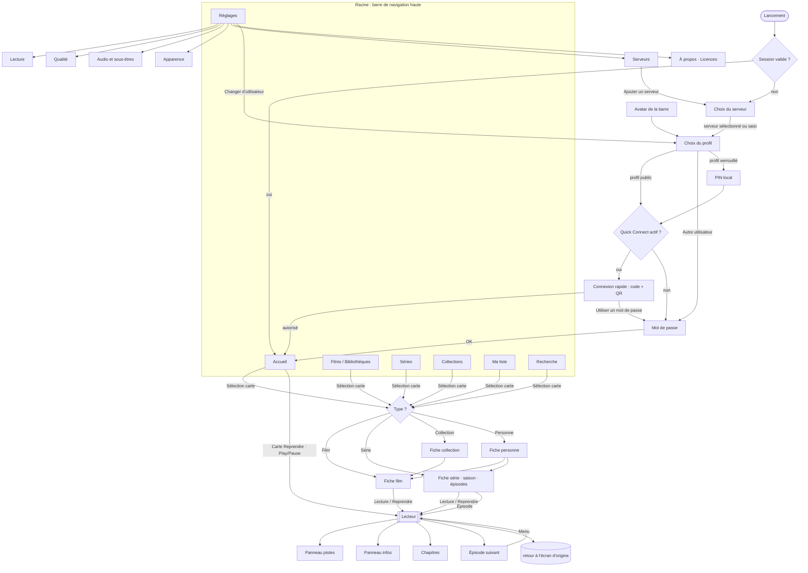

# Plan UI/UX tvOS — Phase 3

Statut : proposition, à valider par Antonin avant le premier commit de code UI.
Périmètre : tvOS 17+, SwiftUI pur. iOS / iPadOS viennent après (§12) sans contraindre ce design.
Maquettes : `docs/design/mockups/index.html` (11 écrans, 1920×1080, statiques). Contexte produit et phases :
`.claude/plans/reboot-appletv-swift-natif.md` du dépôt `jellyfuse`. Ce document ne touche ni au player (Phase 1, validé)
ni au cœur Jellyfin (Phase 2) : il en consomme les API.

Sommaire : 1 principes · 2 identité visuelle · 3 système visuel (tokens) · 4 conventions d'architecture ·
5 navigation · 6 écrans · 7 composants · 8 focus engine (règles transverses) · 9 données Jellyfin ·
10 états transverses · 11 ordre de construction · 12 divergences iOS · 13 hors périmètre · 14 questions ouvertes.

---

## 1. Principes

1. **L'ADN Netflix, pas la copie.** On garde : fond sombre immersif, billboard héro plein écran, shelves horizontales
   d'affiches, focus qui grossit, chrome minimal, typographie forte. On ne garde pas : autoplay de bandes-annonces,
   « % de correspondance » (Jellyfin n'a pas de moteur de reco), rouge, logo, vocabulaire. L'identité est la nôtre (§2).
2. **Le focus est le design.** Sur tvOS il n'y a ni curseur ni tap : chaque écran est d'abord un graphe de focus. Pour
   chaque écran on décide l'élément focus par défaut, les voies de sortie, ce que fait Menu et ce que fait Lecture/Pause
   (§6, §8). Une maquette sans état de focus n'est pas une maquette.
3. **Une action fréquente = au plus 2 clics depuis l'Accueil.** Reprendre un film : 1 clic. Lancer le prochain épisode : 1 clic.
   Changer de piste audio : 2 gestes (bas, sélection) sans quitter la lecture.
4. **Le contenu est l'interface.** Affiches et backdrops portent l'écran ; le texte est court, gros, lisible à 3 m.
5. **Rien n'est bloquant.** Squelettes de la forme finale, pas de spinner plein écran, première image depuis le cache
   puis revalidation (§10).
6. **Complet côté Jellyfin, honnête côté limites.** Tout ce qu'un client vidéo Jellyfin sait faire est dans le périmètre
   (§13 liste ce qui n'y est pas, avec la raison). Ce que le serveur ne fournit pas n'est pas inventé.

## 2. Identité visuelle (proposition)

- **Nom d'écran** : `jellyfuse`, en minuscules, sans espace. **Wordmark** : étincelle à quatre branches (symbole de la
  « fuse ») en dégradé violet → rose, suivie de `jelly` en blanc et `fuse` en dégradé. Graisse ExtraBold, interlettrage
  -1 pt. Rendu dans les maquettes (`.logo`). Le symbole seul sert d'icône d'app et de point de focus de marque
  (spinner, état vide). Un SVG source sera produit au moment de l'icône (Phase 4).
- **Accent** : « Fuse Violet » `#8A6CFF`, avec une étincelle rose `#FF5C8A` ; le dégradé 135° violet → magenta → rose
  (`#8A6CFF → #C65BDB → #FF5C8A`) est réservé à : la progression de lecture, le mot `fuse` du wordmark, l'onglet actif, le
  bouton primaire de l'onboarding. Un clin d'œil à la teinte violette de Jellyfin, volontairement loin du rouge Netflix.
- **Ton** : sobre, cinéma, un peu techno (badges 4K / HDR / Atmos visibles, car c'est ce que le public Jellyfin
  cherche). Pas d'humour dans l'UI.
- **Focus signature** : l'élément ciblé grossit, prend un liseré blanc de 5 pt et une lueur violette diffuse. Le blanc
  reste lisible sur n'importe quelle affiche ; la lueur donne l'identité (§3.5).

## 3. Système visuel

Toutes les valeurs vivent dans `DesignSystem` (namespace `Design`, §4). **Aucun nombre brut dans une vue** : une
valeur nouvelle devient d'abord un token (règle d'Oisillon, `docs/design/design-system.md`).

### 3.1 Palette

Thème sombre uniquement (pas de clair sur tvOS pour une app vidéo ; la maquette fait foi).

| Token `Design.Palette` | Hex | Usage |
|---|---|---|
| `canvas` | `#07070B` | fond de tous les écrans |
| `surface` | `#101018` | barres latérales, panneaux, rangées de réglages |
| `raised` | `#181824` | cartes de dialogue, chips au repos (à 10 % blanc) |
| `overlay` | `#212131` | panneaux flottants (pistes, info) sous flou |
| `stroke` | blanc 10 % | filets, contours de panneaux |
| `textPrimary` | `#F4F4F8` | titres, libellés |
| `textSecondary` | `#A6A6B8` | synopsis, méta (8,3:1 sur `canvas`) |
| `textTertiary` | `#6E6E82` | aides, légendes (4,0:1 : réservé aux textes ≥ 29 pt, jamais à une info essentielle) |
| `accent` | `#8A6CFF` | sélection, liens, coche (4,9:1) |
| `spark` | `#FF5C8A` | fin du dégradé, notification « nouveau » |
| `accentGradient` | `#8A6CFF → #C65BDB → #FF5C8A` | progression, onglet actif |
| `success` | `#3DDC97` | vu, serveur joignable, interrupteur actif |
| `warning` | `#FFB84D` | note communautaire (★), transcodage |
| `danger` | `#FF5A5F` | erreurs, déconnexion |
| `focusRing` | `#FFFFFF` | liseré de focus |
| `focusGlow` | `#8A6CFF` à 45-50 % | lueur de focus |

Les backdrops sont assombris par trois dégradés fixes (`Design.Scrim`) : **gauche** `canvas` 96 % → 0 % sur 70 % de la
largeur (lisibilité du texte), **bas** `canvas` 100 % → 0 % sur 60 % de la hauteur (fondu vers les shelves), **haut**
`canvas` 80 % → 0 % sur 24 % (barre de nav). Pas de texte posé sans scrim.

Couleur dominante : pour la fiche détail, on tire une teinte du backdrop (`UIImage` → moyenne HSB réduite) afin de
teinter légèrement le scrim ; optionnel, derrière un test de contraste automatique (jamais sous 4,5:1).

### 3.2 Typographie

SF Pro (police système, pas de police embarquée). tvOS n'a pas de Dynamic Type utilisateur : tailles fixes en points sur
1920×1080, alignées sur les styles de la HIG tvOS, graisses relevées pour l'effet « affiche ».

| Rôle `Design.Typography` | Taille | Graisse | Usage |
|---|---|---|---|
| `billboardTitle` | 104 | Heavy, -3 | titre du billboard et de la fiche (si pas de logo) |
| `largeTitle` | 76 | Heavy, -1,5 | titre d'écran (Films, Réglages) |
| `title1` | 66 | Bold | titre de page secondaire |
| `title2` | 57 | Bold | titre d'OSD, de dialogue |
| `title3` | 48 | Bold | sous-titre de dialogue |
| `shelfTitle` | 38 | Bold | en-tête de shelf |
| `callout` | 31 | Medium | boutons, onglets, chips, lignes de réglages |
| `body` | 29 | Regular/Medium | synopsis, méta |
| `caption` | 25 | Medium | sous-légendes de carte, en-têtes de groupe (majuscules espacées +2 pt) |
| `caption2` | 23 | Medium | tailles minimales (aide, badge) |
| `timecode` | 27 | Medium, chiffres tabulaires | temps du player |

Plancher : 23 pt (HIG). Le titre d'un billboard utilise le **logo transparent Jellyfin** (`ImageType.logo`) quand il
existe, le texte `billboardTitle` sinon.

### 3.3 Grille et espacements

- Écran 1920×1080 pt. **Zone sûre : 90 pt à gauche et à droite, 60 pt en haut et en bas.** Les shelves partent de la
  marge de 90 pt, mais **défilent jusqu'au bord** (peek de la carte suivante) : on voit toujours qu'il y a une suite.
- Échelle `Design.Spacing` : 8 · 12 · 16 · 24 · 32 · 40 · 56 · 90. Alias : `shelfGap` 40 (entre cartes),
  `shelfTitleToRow` 26, `screenMargin` 90, `sectionGap` 56, `navHeight` 170 (barre + fondu).
- Tailles de cartes (`Design.Size`) : **affiche 250×375** (2:3, 6 visibles + peek), **paysage 400×225** (16:9, 4
  visibles + peek), **personne** disque 150-190, **épisode** 400×225 + titre 2 lignes, **avatar de profil** 230.
- Rayons (continus) : carte 14, bouton pilule = hauteur/2, panneau 28, rangée de réglage 22.
- **Marge de focus** : une carte focalisée grossit de 12 % ; chaque shelf réserve donc 40 pt en haut et en bas
  (`scrollClipDisabled()` + padding) pour que ni le scale ni l'ombre ne soient coupés.

### 3.4 Boutons et chips

- `FuseButton` : hauteur 84, pilule, 31 pt Bold. Styles : `primary` (blanc sur focus, translucide au repos),
  `secondary`, `icon` (rond 84). Au focus : fond blanc, texte `canvas`, scale 1,08, ombre + lueur.
- `FuseChip` : hauteur 60, 27 pt SemiBold. Au repos fond blanc 10 % ; sélectionné fond blanc ; focus = sélectionné +
  scale 1,08.
- Un seul bouton primaire par écran de contenu (Lecture / Reprendre).

### 3.5 Règles de focus (visuelles)

| Élément | Scale | Liseré | Ombre | Notes |
|---|---|---|---|---|
| Carte (affiche, paysage, épisode, personne) | 1,12 | blanc 5 pt | noir 65 % 36/70 + lueur violette 90 | légère parallaxe de l'image (`.card` natif quand possible), légende passe en blanc plein |
| Bouton / chip | 1,08 | fond blanc (inversion) | noir 55 % + lueur 70 | texte inversé |
| Rangée de réglage / de licence | 1,025 | fond blanc (inversion) | noir 55 % | pas de scale fort : la rangée est large |
| Avatar de profil | 1,14 | blanc 8 pt | noir + lueur 100 | libellé blanc Bold |
| Touche du clavier (recherche) | 1,14 | fond blanc | noir | |
| Onglet de la barre de nav | — | fond blanc 16 % | — | l'onglet **actif** garde un soulignement dégradé |

Mouvement (`Design.Motion`) : ressort `duration 0,30 s, bounce 0,15` pour tout focus ; fondu 0,6 s pour le billboard ;
fondu 0,25 s entre écrans (le backdrop identique d'une fiche à l'autre fait la continuité, pas un zoom). Si
`accessibilityReduceMotion` : plus de scale animé, seulement le liseré et le fond ; plus de ken-burns ni de rotation du
billboard.

## 4. Conventions d'architecture (alignées sur sillon et oisillon)

Études : `~/projects/sillon` (Swift 6, XcodeGen, `Packages/SillonKit`, `App/Shared`, `AppModel` main actor, vues
minces, façade `actor JellyfinClient` sur `jellyfin-sdk-swift`) et Oisillon (dépôt local `~/projects/poste`, le
répertoire `~/projects/oisillon` n'existe pas : `App/Shared/Design/DesignSystem.swift`, enum `Design` à sous-espaces
`Spacing`/`Radius`/`Emphasis`/`Motion`, règle « aucun nombre brut dans une vue », `docs/design/design-system.md`,
maquettes HTML de référence dans `docs/design/`, `prototype/`). On reprend :

| Règle | Origine | Application ici |
|---|---|---|
| La logique vit dans le package, les vues restent minces | sillon, oisillon | `Packages/JellyKit` porte tout ce qui se teste sans UI ; `Apps/Jellyfuse` ne parle jamais au réseau |
| `AppModel` `@MainActor @Observable` unique + `report(_:otherwise:)` pour les erreurs | sillon | session, serveur courant, erreurs, état réseau ; une erreur réseau = un bandeau, le reste = alerte de l'écran |
| Namespace de tokens `Design`, valeurs nommées | oisillon | `DesignSystem/Design.swift` (§3) |
| Docs de design versionnées + maquettes HTML | oisillon | ce dossier `docs/design/` ; une capture par écran réel comparée à la maquette avant de clore |
| Tests swift-testing (`@Test`, `#expect`), réseau par `URLProtocol` | sillon, oisillon | logique du DesignSystem et des modèles d'écran testée sans simulateur |
| Texte français dans le code = clé ; en (et es) dans `.xcstrings` | sillon, oisillon | `String(localized:)`, test « chaque clé a ses traductions » |
| Concurrence stricte Swift 6, pas de `@unchecked Sendable` sans commentaire | sillon, oisillon | le seul bloc justifié existant est `MpvPlayer` |
| `project.yml` XcodeGen fait foi | sillon, oisillon, déjà ici | nouvelles cibles ajoutées dans `project.yml` / `Package.swift` |
| Arguments de lancement Debug pour rejouer un scénario | sillon (`-SillonServerOverride`…) | `-JellyfuseServer <url>`, `-JellyfuseOpen detail:<id>`, `-JellyfuseGallery` (galerie du DesignSystem, sans serveur) |

### 4.1 Découpage cible

```
Packages/JellyKit/Sources/
├── DesignSystem/     # NOUVEAU. SwiftUI seul : zéro dépendance Jellyfin, zéro réseau
│   ├── Design.swift          # tokens : Palette, Typography, Spacing, Size, Radius, Motion, Focus, Scrim
│   ├── Foundations/          # FocusableStyle, Artwork, Skeleton, Badge, ProgressBar, GradientText
│   ├── Cards/                # PosterCard, LandscapeCard, EpisodeCard, PersonCard, ProfileAvatar
│   ├── Layout/               # Shelf, Billboard, TopNav, PosterGrid, LetterRail, ChipRow
│   ├── Player/               # PlayerOSD, Scrubber, TrickplayBubble, TrackPanel, SkipButton, UpNextCard
│   ├── Forms/                # SettingsRow, SettingsSidebar, PinPad, QuickConnectCode
│   └── Models/               # modèles d'affichage (valeurs) : PosterModel, EpisodeModel, OSDState…
├── LibraryKit/       # existant : façade du SDK + modèles du domaine (MediaItem…)
├── PlayerCore/       # existant : mpv
├── PlaybackEngine/   # Phase 2 : device profile, resolver, reporter, mémorisation pistes
└── AppModel/         # Phase 2 : Session/SessionStore, réglages (SwiftData)
Apps/Jellyfuse/
├── JellyfuseApp.swift, RootView.swift, AppModel.swift
├── Presentation/     # LibraryKit → DesignSystem.Models (mappers purs, testés)
└── Features/         # un dossier par écran : Auth/ Home/ Detail/ Library/ Search/ Player/ Settings/
                      #   chaque feature = View (mince) + XxxModel (@Observable, appelle le client)
```

**Règle de dépendance** : `DesignSystem` ne connaît ni `LibraryKit` ni le SDK. Ses vues reçoivent des **modèles
d'affichage** (valeurs `Sendable, Equatable, Identifiable`) et émettent des callbacks. `Presentation/` traduit
`MediaItem`/`BaseItemDto` en modèles d'affichage. Cela garde le DesignSystem testable, prévisualisable (`#Preview`
avec données fictives) et réutilisable par la future cible iOS.

### 4.2 Composants purs : props-in, callbacks-out

Exemple de signature de référence, valable pour tous les composants :

```swift
public struct PosterModel: Sendable, Equatable, Identifiable {
    public let id: String
    public let title: String
    public let image: ArtworkSource            // url + blurhash + aspect
    public let progress: Double?               // 0...1, nil = pas de barre
    public let isWatched: Bool
    public let badge: Badge?                   // .new, .count(n)
}

public struct PosterCard: View {
    public init(_ model: PosterModel, onSelect: @escaping () -> Void, onLongPress: @escaping () -> Void = {})
    // le focus est lu via @Environment(\.isFocused) ; aucun état métier dans la vue
}
```

Le composant n'importe rien de `Features/` ; la navigation et les mutations sont des callbacks fournis par l'écran.
Pas de `memoize` manuel, pas de singleton, pas de `ObservableObject` : `@Observable` uniquement dans les `XxxModel` des
features.

### 4.3 État et données

- Un `XxxModel` `@MainActor @Observable` par écran (`HomeModel`, `DetailModel`, `LibraryModel`, `SearchModel`,
  `SettingsModel`), construit avec le `JellyfinClient` de la session. Il expose des **modèles d'affichage** et un état
  `Loadable<T>` (`idle | loading | loaded(T) | failed(Error)`), jamais un `[BaseItemDto]` brut.
- **Pas de store maison généralisé** (décision du plan de reboot). Exception raisonnable : un cache disque de la Home
  (dernier résultat de chaque shelf, par propriétaire = serveur + utilisateur, comme `libraryOwner` de sillon) pour
  afficher quelque chose au lancement avant le réseau. Images : Nuke (`ImagePipeline` + `ImageCache` disque 500 Mo).
- Websocket Jellyfin (`socketSession()` de sillon) : `UserDataChanged` rafraîchit « Reprendre » et « À suivre »,
  `LibraryChanged` marque les shelves « Ajoutés récemment » obsolètes.
- **Mutations optimistes** (vu, ma liste) : on patche le modèle local d'abord, l'appel part ensuite, rollback + `report`
  en cas d'erreur.

## 5. Navigation



- **Racine** : barre de navigation haute personnalisée (`TopNav`), dans une zone de focus dédiée. Onglets dynamiques :
  `Accueil`, une entrée par bibliothèque vidéo du serveur (type `movies` → *Films*, `tvshows` → *Séries*, `boxsets` →
  *Collections*, `homevideos`/`mixed` → nom de la bibliothèque), `Ma liste`, `Recherche`, `Réglages`. Si deux
  bibliothèques ont le même type, l'onglet gère un sélecteur de bibliothèque (chip « Toutes / Films 4K / Enfants »).
  Musique, livres, photos : masqués en v1 (Sillon couvre la musique).
- **Profondeur** : Racine → fiche → (sous-fiche) → Lecteur. Chaque niveau est une `NavigationStack` pushée ; le lecteur
  est présenté en `fullScreenCover`.
- Deep links : `jellyfuse://item/<id>`, `jellyfuse://play/<id>` (Top Shelf en Phase 4, Siri plus tard).

## 6. Écrans

Légende : **F0** = focus par défaut · **Menu** = bouton Menu/Retour de la télécommande · **▶︎⏸** = bouton Lecture/Pause
· **LP** = appui long sur Sélection (menu contextuel).

### 6.1 Auth

#### A1. Choix du serveur
- **But** : trouver ou saisir un serveur Jellyfin.
- **Contenu** : liste « Serveurs détectés » (découverte UDP du SDK, `JellyfinClient.discover`, port 7359), « Serveurs récents »,
  bouton « Saisir une adresse ». Chaque ligne : nom + version + URL + pastille d'état.
- **F0** : le dernier serveur utilisé, sinon le premier détecté, sinon « Saisir une adresse ».
- **Saisie d'adresse** : champ texte tvOS (clavier ; la saisie depuis l'iPhone voisin est offerte nativement par le
  système). Validation par `getPublicSystemInfo` : on affiche nom + version avant de continuer. `http://` accepté
  (serveurs LAN), `https://` suggéré si le serveur répond dessus.
- **Menu** : si une session existe, retour à l'app ; sinon sortie vers le Home Apple TV. **▶︎⏸** : sans effet.
- **États** : recherche en cours (sablier discret à côté du titre « Serveurs détectés »), aucun serveur détecté (état
  vide avec instructions), serveur injoignable (ligne rouge + « Réessayer »).

#### A2. Choix du profil (`profiles.html`)
- **But** : multi-utilisateurs. Avatars des utilisateurs publics du serveur + « Ajouter » (autre utilisateur, nom +
  mot de passe) ; chips : serveur courant, « Changer de serveur », « Gérer les profils ».
- **F0** : le dernier profil utilisé. Gauche/droite = parcourir ; bas = chips.
- **Verrou** : un cadenas indique un profil protégé par **PIN local**. Jellyfin ne propose pas d'authentification par
  PIN côté serveur exploitable par un client (le code simple est stocké mais non utilisé pour s'authentifier) : le PIN
  est une protection **de l'app sur cet Apple TV** (4 chiffres, haché dans le Keychain) qui garde le jeton de session
  derrière. Il protège contre un autre habitant du salon, pas contre un attaquant (cf. §14, Q3).
- **Sélection** d'un profil dont la session est déjà mémorisée → Accueil direct ; sinon A4/A5. **LP** : « Oublier ce
  profil », « Définir/Changer le PIN ».
- **Menu** : retour au choix du serveur (ou à l'app si lancé depuis Réglages).
- **Données** : `getPublicUsers`, `getUserImage` (avatar ; à défaut initiale sur dégradé stable dérivé de l'ID).

#### A3. PIN local
Dialogue plein écran, `PinPad` 4 chiffres : clavier numérique focusable 3×4 ; la télécommande saisit aussi les
chiffres. Erreur = secousse + « Code incorrect », verrou temporisé après 5 essais (30 s, doublé à chaque série).
**Menu** annule.

#### A4. Connexion rapide (`login.html`)
- **But** : se connecter sans clavier. Code à 6 chiffres en très gros (`Design.Typography.quickConnectDigit`), 3 étapes
  numérotées, **QR code** vers `http(s)://<serveur>/web/#/quickconnect` (la page web du serveur où l'utilisateur
  saisit le code), compte à rebours de validité, spinner « En attente d'autorisation… ».
- **F0** : « Utiliser un mot de passe ». Gauche/haut : sans objet (un seul focusable utile). Le code n'est **pas** un
  champ focusable.
- **Flux** : `getQuickConnectEnabled` → `initiateQuickConnect` → polling 5 s `getQuickConnectState` (le SDK fournit
  `QuickConnect.connect(...)` qui enchaîne) → `authenticateWithQuickConnect` → session → Accueil. Expiration (≈ 5 min) :
  nouveau code automatique, le focus ne bouge pas.
- **Menu** : annule le polling, retour à A2. **▶︎⏸** : sans effet.
- **Si Quick Connect est désactivé** sur le serveur : l'écran est sauté, on ouvre A5 avec un bandeau explicatif.

#### A5. Mot de passe
Deux champs (nom d'utilisateur pré-rempli si profil choisi, mot de passe), bouton « Se connecter », lien « Utiliser la
connexion rapide ». Mot de passe vide accepté (comptes Jellyfin sans mot de passe). Erreurs : « Identifiants
incorrects », « Serveur injoignable ». `authenticateUserByName`.

### 6.2 Accueil (`home.html`)
- **Structure** (de haut en bas) : barre de nav · **Billboard** (≈ 640 pt) · shelves :
  1. **Reprendre la lecture** (paysage, barre de progression, « 28 min restantes ») — `getResumeItems`
  2. **À suivre** (paysage, prochain épisode de chaque série suivie) — `getNextUp` (`enableRewatching` désactivé)
  3. **Ajoutés récemment** par bibliothèque (une shelf par bibliothèque : « Films récents », « Séries récentes ») —
     `getLatestMedia(parentID:)`
  4. **Recommandations** : « Parce que vous avez regardé X » — `getMovieRecommendations` (si le serveur renvoie quelque
     chose)
  5. **Ma liste** (si non vide) — favoris
  6. Une shelf **par genre favori** (v1.1, dérivée de l'historique)
  L'ordre est paramétrable en v1.1 ; en v1 c'est celui-ci, les shelves vides sont masquées.
- **Billboard** : jusqu'à 6 éléments. Source : le premier « Reprendre » (état « Reprendre » sur le bouton), puis des
  films/séries non vus avec backdrop (`getItems`, `isUnplayed`, `sortBy: random`, `limit: 12`, filtrés côté client sur
  `BackdropImageTags` non vide). Backdrop plein écran (ken-burns 12 s), logo ou titre, méta (★ note communautaire,
  année, durée, classification, badges 4K / HDR / Atmos), synopsis 2 lignes, boutons **Lecture/Reprendre**, **Ma liste**,
  **Infos**. Rotation toutes les 8 s uniquement quand le billboard n'a pas le focus ; un clic gauche/droit sur le
  billboard passe à l'élément suivant/précédent.
- **F0** : bouton **Lecture** du billboard. Bas : première shelf, carte mémorisée sinon la première. La carte focalisée
  d'une shelf **ne change pas** le billboard (pas de mise à jour de fond au focus, pour éviter l'agitation) ; la maquette
  montre l'état « focus descendu dans la première shelf », le billboard reste affiché au-dessus puis défile hors champ
  quand le focus descend à la deuxième shelf.
- **Menu** : sur le contenu, premier appui = remonter en haut + focus sur la barre de nav ; sur la barre, comportement
  système (retour au Home Apple TV). **▶︎⏸** sur une carte : lance la lecture (reprise). **LP** sur une carte : menu
  contextuel (Marquer comme vu/non vu, Ajouter à Ma liste, Aller à la série, Informations).
- **États** : lancement = squelettes (billboard flou + 2 shelves fantômes) ; dernier résultat du cache affiché tout de
  suite ; serveur injoignable = bandeau « Hors connexion » sous la nav + cache.

### 6.3 Fiche film (`detail-movie.html`)
- **Structure** : backdrop plein écran + scrims ; colonne gauche (genres, titre/logo, méta, synopsis 3 lignes,
  actions, sélecteurs) ; colonne droite haute (réalisation, écriture, studio) ; sous le pli : **Distribution**
  (disques), **Extras** (si présents), **Similaires**, **Collection** (si le film en fait partie), **Détails**
  (langues audio, sous-titres, durée, taille, chemin masqué).
- **Actions** (rangée) : **Lecture / Reprendre · 1 h 12** (primaire), **Depuis le début** (si une position existe),
  **Vu** (icône, bascule), **Ma liste** (icône cœur ; favori Jellyfin). **Bande-annonce** : absente en v1 (les
  `RemoteTrailers` pointent vers YouTube, non lisible) ; les `LocalTrailers`/`SpecialFeatures` éventuels passent par
  *Extras*.
- **Sélecteurs** (chips) : **Version** (si plusieurs `MediaSources` : « 4K HEVC · 18 Mb/s », « 1080p H.264 »),
  **Audio**, **Sous-titres** ; chacun ouvre un panneau de choix (même composant que dans le player). Le choix s'applique
  à la prochaine lecture ; l'initial respecte les préférences de l'utilisateur serveur (§9.4).
- **F0** : bouton primaire. Haut : barre de nav ; bas : chips puis distribution. **Menu** : retour (pop). **▶︎⏸** :
  lance la lecture. **LP** sur une personne : « Voir sa fiche ».
- **Transition** : depuis une carte, fondu avec conservation du backdrop (même image mise en cache) ; pas de zoom
  hérité (non garanti sur tvOS, cf. §14).

### 6.4 Fiche série / saison / épisode (`detail-series.html`)
- **Structure** : même tête que le film (genres, titre, méta « 2022 – 2025 · 32 épisodes », synopsis 2 lignes), bouton
  primaire **Reprendre S2 · E5** (ou **Lecture S1 · E1** si rien vu), **Ma liste**, **Favori**, **Tout marquer vu**.
  Rangée de **chips de saisons** (+ **Extras** si `getSpecialFeatures` non vide), puis **rangée d'épisodes** (cartes
  paysage 400×225, numéro, titre, durée, barre de progression, coche « vu »).
- **Épisode focalisé** : la carte grossit et développe sous elle son synopsis (2 lignes) ; **LP** ou bouton « i »
  ouvre la **fiche épisode** (feuille modale : synopsis complet, date de diffusion, média : résolution, codecs, pistes
  — `EpisodeInfoSheet`). Il n'y a **pas d'écran épisode séparé** : un épisode est toujours atteint via sa série
  (ouvrir un épisode depuis la recherche = ouvrir la série avec cet épisode focalisé).
- **Saison** : un chip de saison charge la rangée d'épisodes de cette saison (`getEpisodes(seasonID:)`) ; la saison
  initiale est celle de l'épisode « À suivre ». Les saisons à un épisode ou « Spéciaux » se comportent pareil.
  Au-delà de 12 épisodes, la rangée reste horizontale (pagination incrémentale par `startItemID`).
- **F0** : bouton primaire. Bas : chips de saisons (le chip actif d'abord), puis épisodes (l'épisode « à suivre »
  d'abord, rangée pré-défilée dessus). **Menu** : retour. **▶︎⏸** sur un épisode : lecture directe.
- **Sous le pli** : Distribution, Similaires, Détails.
- **États** : saison sans épisode (« Aucun épisode »), épisodes manquants masqués (`isMissing: false`).

### 6.5 Fiche collection et fiche personne
- **Collection (BoxSet)** : tête compacte (titre, nombre de films, bouton « Tout lire » en ordre de sortie) puis grille
  d'affiches (§6.6). **Personne** : disque, biographie courte, grille « Filmographie » (films et séries) triée par
  année. Même composant `PosterGrid`, mêmes règles de focus.

### 6.6 Bibliothèque (`library.html`)
- **But** : parcourir Films / Séries / Collections / bibliothèque personnalisée.
- **Structure** : titre + total (« 1 284 titres · triés par titre ») ; en haut à droite **Tri** (Titre A-Z, Date
  d'ajout, Date de sortie, Note, Durée, Aléatoire ; ordre inversable) et **Filtres** (Non vus, Favoris, Genres,
  Années, Classifications, Studios, Résolution) et un raccourci **Non vus** ; rangée de **chips de genres** ; **grille
  d'affiches 6 colonnes** ; **rail A-Z** vertical sur le bord droit (visible quand le tri est alphabétique).
- **F0** : première affiche (ou l'affiche mémorisée au retour). Haut depuis la première ligne : chips de genres, puis
  tri/filtres, puis barre de nav. Droite depuis la dernière colonne : rail A-Z ; haut/bas dans le rail = lettre, gauche
  = retour à la grille, **sélection d'une lettre** = saut à cette lettre (`nameStartsWithOrGreater`).
- **Chargement** : pagination par pages de 60 (`startIndex`/`limit`), préchargement à 2 lignes de la fin ; squelette de
  lignes pour les pages en vol. **Menu** : de la grille → remonte en haut + focus nav ; **▶︎⏸** sur une affiche : lecture.
  **LP** : menu contextuel (vu, favori, infos).
- **États** : filtre sans résultat (« Aucun résultat. Effacer les filtres » en bouton), bibliothèque vide, erreur de
  page (ligne « Réessayer » au bout de la grille).

### 6.7 Recherche (`search.html`)
- **Structure** : champ + **clavier tvOS** natif (`.searchable`, donc dictée Siri, saisie depuis l'iPhone, suggestions),
  chips de filtre **Tout / Films / Séries / Épisodes / Personnes**, résultats **groupés en shelves** (Films, Séries,
  Épisodes, Personnes). Pas de requête avant 2 caractères ; 300 ms de pause de frappe ; une réponse tardive est
  abandonnée (règle reprise de `CatalogSearch` de sillon).
- **Avant la frappe** : « Recherches récentes » (locales) et « Tendances dans votre bibliothèque » (récemment ajoutés).
- **F0** : le clavier. Bas : chips, puis premier résultat. **Menu** : efface la requête, puis quitte vers Accueil.
- **Données** : `getSearchHints` (rapide, par type) pour remplir les shelves, hydratées par `getItems(ids:)` ;
  `getPersons` pour les personnes.

### 6.8 Lecteur (`player-osd.html`, `player-tracks.html`)

Plein écran, mpv dessous (surface `PlayerCore`), tout le reste est SwiftUI au-dessus.

**États de l'OSD** (`OSDState`) : `hidden` → `transport` → `scrubbing` → `panel(tracks | info | chapters)` ; `upNext`
et `skip` se superposent à `hidden`/`transport`.

| État | Contenu | Commandes |
|---|---|---|
| `hidden` | vidéo seule (+ sous-titres rendus par mpv) | **Sélection** : pause/lecture + `transport` ; **Gauche/droite** : saut arrière 10 s / avant 30 s (réglable) ; **Haut** : `transport` ; **Bas** : panneau pistes ; **▶︎⏸** : pause/lecture ; **Menu** : quitter |
| `transport` | titre (série · saison / épisode), horloge + « se termine à », **scrubber** (position, tampon, repères de chapitres, segments), temps écoulé / restant, rangée de boutons : Précédent, Épisode suivant, ▶︎/⏸, Audio, Sous-titres, Infos | masqué après 5 s sans commande ; **Gauche/droite** sur le scrubber : saut ; **Glisser sur le pavé tactile** : `scrubbing` ; **Bas** : focus sur la rangée de boutons ; **Menu** : `hidden` |
| `scrubbing` | `transport` + **bulle trickplay** (vignette 16:9, horodatage, nom du chapitre) qui suit la tête de lecture | glisser / clic gauche-droit = déplacer ; **Sélection** : valider la position ; **Menu** : annuler et revenir à la position d'origine |
| `panel(tracks)` | volet droit : colonnes **Audio** (langue, codec, canaux) et **Sous-titres** (Désactivés, forcés, langues, SDH) ; coche sur le choix actif | haut/bas = choix, sélection = applique **immédiatement** et mémorise ; **Menu**/gauche : ferme |
| `panel(info)` | débit, résolution, codecs, **méthode de lecture** (Lecture directe / Flux direct / Transcodage + raison), HDR, pistes | **Menu** : ferme |
| `panel(chapters)` | rangée de vignettes de chapitres (`ImageType.chapter`) | sélection = saut ; Menu : ferme |
| `skip` | bouton **Passer l'intro / le récapitulatif / le générique** en bas à droite, apparaît pendant le segment correspondant, dure 8 s ; **prend le focus à l'apparition** | **Sélection** : saute à la fin du segment ; sans action : disparaît ; si « Passer automatiquement » est actif : saut sans bouton (toast « Intro passée ») |
| `upNext` | carte « Épisode suivant » (vignette, S2 · E6, titre) à l'entrée du générique de fin ou 30 s avant la fin ; compte à rebours 10 s si lecture auto | **Sélection** : lancer maintenant ; **Menu** : annuler, rester sur la fin ; **Bas/haut** : « Regarder le générique » |

- **F0** (quand l'OSD est visible) : le scrubber. **Play/Pause** fonctionne dans tous les états, y compris quand un
  panneau est ouvert (il met en pause sans fermer le panneau).
- **Fin de film** : retour automatique à la fiche (position effacée, marqué vu par le reporter). **Fin de série** :
  retour à la fiche série, focus sur le dernier épisode.
- **Erreurs** : mpv échoue ou le réseau tombe = dialogue « Lecture impossible » avec « Réessayer », « Choisir une autre
  version », « Retour » ; mise en mémoire tampon prolongée (> 3 s) = spinner au centre avec le symbole étincelle.
- **Technique à valider** : le *scrub continu au pavé tactile* n'existe pas en SwiftUI pur sur tvOS ; il faut un pont
  UIKit (`UIPanGestureRecognizer` avec `allowedTouchTypes = [.indirect]`) hébergé dans une `UIViewRepresentable`
  derrière la surface vidéo. Le clic gauche/droit (`onMoveCommand`) fonctionne sans pont. Premier spike du lot 3.4a.
- **Reporting** : start / progress (toutes les 10 s et à chaque pause/seek) / stopped avec `MediaSourceId`,
  `PlayMethod`, `CanSeek` — Phase 2 (`PlaybackEngine`), pas redessiné ici.

### 6.9 Réglages (`settings.html`, `licenses.html`)
Disposition : barre latérale (`surface`) + panneau de lignes. **F0** : la section courante de la barre ; droite = entrer
dans le panneau ; **Menu** depuis le panneau = retour à la barre ; depuis la barre = retour à l'onglet précédent.

| Section | Contenu |
|---|---|
| **Compte** | utilisateur et serveur courants, **Changer d'utilisateur**, **Se déconnecter** (danger, confirmation), **PIN du profil**, « Autoriser une connexion rapide » (v1.1) |
| **Lecture** | Lire l'épisode suivant automatiquement · Passer les intros automatiquement · Passer les récapitulatifs · Passer les génériques de fin · Saut arrière / avant (5-10-15 / 10-30-60 s) · Reprendre au dernier point |
| **Qualité et transcodage** | Débit maximal (Automatique, 120, 60, 40, 20, 10, 5 Mb/s) · Autoriser le transcodage · Forcer la lecture directe · HDR (Automatique / Tone-mapping SDR) · Cache de lecture (mémoire tampon) |
| **Audio et sous-titres** | Langue audio préférée · Mode de sous-titres (Aucun, Forcés, Auto selon l'audio, Toujours) · Langue des sous-titres · Taille / couleur / fond (rendu libass) · Mémoriser les choix par série |
| **Apparence** | Billboard (activé, rotation), Titres sur les affiches, Réduire les animations (suit le réglage système), Langue de l'interface |
| **Serveurs** | liste des serveurs, Ajouter, Oublier |
| **À propos et licences** | Version / build, version de mpv, version du serveur, **Licences** (liste des bibliothèques → texte de la licence), lien du code source, mention « non affilié au projet Jellyfin », export des journaux (v1.1) |

Chaque ligne : titre 31 pt, sous-titre explicatif 23 pt, valeur à droite ; les choix multiples s'ouvrent dans un panneau
liste (même composant que les pistes). Réglages **par utilisateur** synchronisés avec le serveur quand possible
(`DisplayPreferences`, `UserConfiguration`, §9.4) ; réglages **par appareil** (débit, saut, billboard) en local.

**Licences** : liste des composants avec nom + licence, texte intégral en feuille défilable, introduction MIT +
lien du code source, de quoi **re-linker** (obligation LGPL §6). Données générées au build (`THIRD_PARTY_LICENSES`) ;
la CI échoue si un artefact `-GPL` entre dans le graphe (décision du plan de reboot).

### 6.10 Écrans transverses
- **Serveur injoignable** (plein écran si aucun cache, bandeau sinon) : « Impossible de joindre Salon », Réessayer /
  Changer de serveur. F0 = Réessayer.
- **Session expirée (401)** : retour à A2 avec message, le profil reste choisi (reprise du pattern `onUnauthorized`).
- **Vide** : bibliothèque vide, Ma liste vide (« Ajoutez des titres avec ♡ »), recherche sans résultat.
- **Lancement** : écran de lancement fond `canvas` + étincelle ; pas d'écran d'accueil marketing.

## 7. Inventaire des composants DesignSystem

Tous **purs** (§4.2). Les signatures sont des esquisses : `Model` = valeur d'affichage du dossier `Models/`.

### Fondations
| Composant | API esquissée | Rôle |
|---|---|---|
| `Design` | `enum Design { Palette, Typography, Spacing, Size, Radius, Motion, Focus, Scrim }` | tokens (§3) |
| `FocusableStyle` | `ButtonStyle` : `.fuseFocus(scale:, ring:, glow:)` ; lit `\.isFocused` | scale + liseré + lueur, ressort `Motion.focus` ; respecte Reduce Motion |
| `Artwork` | `Artwork(_ source: ArtworkSource, aspect: ArtworkAspect, contentMode)` | image (Nuke `LazyImage`), flou blurhash puis fondu, repli dégradé + initiale |
| `ArtworkSource` | `struct { url: URL?; blurHash: String?; fallbackSeed: String }` | seed stable → dégradé de repli |
| `ProgressBar` | `ProgressBar(value: Double)` | barre 8 pt dégradée |
| `Badge` | `Badge("4K")`, `.filled`, `.outlined` | méta techniques, « NOUVEAU » |
| `MetaLine` | `MetaLine(rating:, year:, runtime:, certification:, badges:)` | ligne ★ · année · durée · classification · badges |
| `GradientText` | `GradientText(_ s: String)` | wordmark, onglet actif |
| `Skeleton` | `Skeleton(shape:)`, `.skeletonShelf(count:)` | formes de chargement, statiques |
| `EmptyState` | `EmptyState(symbol:, title:, message:, action: (label:, run:)?)` | états vides et erreurs |
| `Banner` | `Banner(kind: .offline/.error, message:, onRetry:)` | bandeau réseau (un seul, comme sillon) |

### Boutons et sélecteurs
| Composant | API esquissée | Rôle |
|---|---|---|
| `FuseButton` | `FuseButton(_ title:, symbol:, style: .primary/.secondary/.icon, action:)` | boutons de fiche et de dialogue |
| `FuseChip` | `FuseChip(_ title:, isSelected:, accessory:, action:)` | genres, saisons, filtres, version/audio/sous-titres |
| `ChipRow` | `ChipRow(_ items: [ChipModel], selection: Binding<ChipID?>)` | rangée focusable défilante, `focusSection` |
| `OptionPanel` | `OptionPanel(title:, options: [OptionModel], selection:, onSelect:)` | panneau de choix (tri, débit, langue, pistes) |
| `Toggle` focusable | `FuseToggle(isOn:)` (via `SettingsRow`) | interrupteurs |

### Cartes
| Composant | API esquissée | Notes |
|---|---|---|
| `PosterCard` | `PosterCard(_ model: PosterModel, onSelect:, onLongPress:)` | affiche 2:3, coche « vu », badge, barre de progression |
| `LandscapeCard` | `LandscapeCard(_ model: LandscapeModel, onSelect:, onLongPress:)` | 16:9 ; légende titre + sous-titre ; barre de progression ; fallback sur le backdrop ou la vignette |
| `EpisodeCard` | `EpisodeCard(_ model: EpisodeModel, isExpanded:, onSelect:, onInfo:)` | carte d'épisode avec synopsis déplié au focus |
| `PersonCard` | `PersonCard(_ model: PersonModel, onSelect:)` | disque + nom + rôle |
| `ProfileAvatar` | `ProfileAvatar(_ model: ProfileModel, isLocked:, onSelect:)` | cercle, initiale, cadenas |
| `ServerRow` | `ServerRow(_ model: ServerModel, onSelect:)` | ligne serveur (nom, version, URL, statut) |

### Mise en page
| Composant | API esquissée | Notes |
|---|---|---|
| `Shelf` | `Shelf(title:, items: [Item], card: (Item) -> Card, onSeeAll: (() -> Void)?)` | ScrollView horizontal, `LazyHStack`, `scrollClipDisabled`, `focusSection`, mémorise l'élément focalisé via `focusedID: Binding` |
| `ShelfHeader` | `ShelfHeader(_ title:, trailing:)` | |
| `Billboard` | `Billboard(items: [BillboardModel], index: Binding<Int>, primaryLabel:, onPlay:, onToggleList:, onInfo:)` | backdrop + scrims + méta + boutons, ken-burns, rotation ; focus sur « Lecture » par défaut |
| `BackdropView` | `BackdropView(_ source:, scrim: .left/.bottom/.full, tint: Color?)` | fond de fiche, partagé entre écrans |
| `TopNav` | `TopNav(tabs: [NavTab], selection: Binding<NavTab>, profile: ProfileModel, onProfile:)` | wordmark + onglets + avatar ; zone de focus dédiée |
| `PosterGrid` | `PosterGrid(items:, columns: 6, onSelect:, onLongPress:, onReachEnd:)` | `LazyVGrid`, pagination, mémorisation du focus |
| `LetterRail` | `LetterRail(letters: [Character], selection:, onSelect:)` | rail A-Z |
| `DetailHeader` | `DetailHeader(title:, logo:, meta:, overview:, actions: @ViewBuilder)` | tête commune film / série / collection |
| `SettingsSidebar` / `SettingsRow` | `SettingsRow(title:, subtitle:, accessory: .toggle(Binding)/.value(String)/.chevron)` | réglages et licences |

### Player
| Composant | API esquissée | Notes |
|---|---|---|
| `PlayerOSD` | `PlayerOSD(state: OSDState, model: OSDModel, handlers: OSDHandlers)` | ne connaît pas mpv : `OSDModel` (titres, position, durée, chapitres, segments, pistes) fourni par `PlayerModel` |
| `Scrubber` | `Scrubber(position:, buffered:, duration:, chapters:, segments:, isScrubbing:)` | piste 12 pt, repères, tête de 34 pt ; accessibilité `adjustable` |
| `TrickplayBubble` | `TrickplayBubble(sheet: TrickplaySheet, time:, chapterTitle:)` | découpe la tuile de la planche ; calcul d'index testé (`TrickplaySheet.tile(at:)`) |
| `TransportBar` | `TransportBar(buttons: [TransportButton], onPress:)` | rangée Précédent / Suivant / ▶︎⏸ / pistes / infos |
| `TrackPanel` | `TrackPanel(audio: [TrackOption], subtitles: [TrackOption], onSelect:)` | volet droit (maquette `player-tracks`) |
| `SkipSegmentButton` | `SkipSegmentButton(kind: .intro/.recap/.outro, onSkip:, onTimeout:)` | prend le focus à l'apparition, 8 s |
| `UpNextCard` | `UpNextCard(_ model:, countdown: Duration?, onPlay:, onCancel:)` | |
| `ChapterStrip` | `ChapterStrip(chapters:, onSelect:)` | vignettes de chapitres |
| `InfoPanel` | `InfoPanel(model: PlaybackInfoModel)` | méthode de lecture, flux, débit |

### Authentification
| Composant | API esquissée | Notes |
|---|---|---|
| `QuickConnectCode` | `QuickConnectCode(code: String, remaining: Duration)` | 6 chiffres en cases, décompte |
| `QRCodeView` | `QRCodeView(payload: String)` | génération Core Image (`CIQRCodeGenerator`), fond blanc, marge de silence |
| `PinPad` | `PinPad(length: 4, onComplete: (String) -> Void)` | clavier focusable + saisie des chiffres de la télécommande |

## 8. Focus engine : règles transverses

1. **Zones** : chaque bloc logique est un `focusSection()` (barre de nav, billboard, chaque shelf, chips, rail A-Z,
   rangée d'actions). Le moteur saute ainsi d'une zone à l'autre même si les cartes ne sont pas alignées.
2. **Focus par défaut** : `@Namespace` + `.prefersDefaultFocus(true, in:)` + `.focusScope`, jamais de `DispatchQueue`
   pour forcer le focus. Sur les écrans « liste », le `defaultFocus` suit un **ID mémorisé** (`focusedID`).
3. **Restauration** : au retour d'une fiche, le focus retrouve la carte d'où l'on est parti (ID mémorisé dans le
   `XxxModel` de l'écran source, clé = identifiant de route), et le défilement vertical est restauré avec lui.
4. **Menu (retour)** : toujours `.onExitCommand` explicite sur les racines d'onglet (haut + nav, puis système) ; les
   fiches et sous-écrans laissent la `NavigationStack` faire le pop ; les panneaux et dialogues ferment leur panneau.
   Jamais de « piège » : un utilisateur peut toujours sortir en trois Menu au plus.
5. **Lecture/Pause** : `.onPlayPauseCommand` sur les cartes lisibles (lance), sur le player (bascule), nulle part
   ailleurs.
6. **Appui long (Sélection maintenue)** : `.contextMenu` sur toutes les cartes lisibles.
7. **Scrolling** : pas de `ScrollViewReader.scrollTo` animé pendant que le focus bouge (provoque des sauts) ; utiliser
   `scrollPosition(id:)` et laisser le moteur suivre le focus.
8. **Billboard** : le focus ne doit **jamais** déclencher de changement de contenu ailleurs (anti-agitation) ; seul un
   clic gauche/droit sur le billboard change d'élément.
9. **Accessibilité** : chaque carte porte un `accessibilityLabel` complet (« Nocturne, film, 2025, reprise à 62 % ») ;
   VoiceOver tvOS parcourt les shelves ; `accessibilityAdjustableAction` sur le scrubber.
10. **Tests du graphe de focus** : tests UI sur simulateur (XCUITest `XCUIRemote.shared.press(.right)`) pour les
    parcours critiques (Accueil → fiche → lecture → Menu → Accueil avec focus restauré). Les règles pures (mémorisation
    de focus, calcul de lettre, indexation trickplay) sont en swift-testing sans simulateur.

## 9. Données : écran → Jellyfin

Toutes les ressources passent par le SDK officiel `jellyfin-sdk-swift` (règle dure du plan de reboot), derrière la
façade `actor JellyfinClient` de `LibraryKit` ; les noms ci-dessous sont ceux des `Paths.*` du SDK (vérifiés dans
`Sources/Paths`). Les champs `BaseItemDto` nécessaires se demandent par `fields:` (jamais le DTO complet par défaut).

### 9.1 Tableau par écran

| Écran | Ressource SDK | Paramètres clés | Alimente |
|---|---|---|---|
| Serveurs (A1) | `JellyfinClient.discover` (SDK, UDP 7359), `getPublicSystemInfo` | durée 5 s ; URL saisie | liste des serveurs détectés, validation d'une adresse |
| Profils (A2) | `getPublicUsers`, `getUserImage` | — | avatars |
| Quick Connect (A4) | `getQuickConnectEnabled`, `initiateQuickConnect`, `getQuickConnectState`, `authenticateWithQuickConnect` (via `QuickConnect.connect`) | secret conservé en mémoire ; polling 5 s | code, session |
| Mot de passe (A5) | `authenticateUserByName` | — | session (jeton, userID) |
| Accueil · nav | `getUserViews` | — | onglets dynamiques (type de collection) |
| Accueil · Reprendre | `getResumeItems` | `mediaTypes: [.video]`, `fields: [.overview, .mediaSources…]`, `enableUserData`, `limit 20` | shelf paysage |
| Accueil · À suivre | `getNextUp` | `enableRewatching: false`, `disableFirstEpisode: false` | shelf paysage |
| Accueil · Récents | `getLatestMedia` | `parentID` par bibliothèque, `limit 20`, `groupItems: true` | shelves d'affiches |
| Accueil · Billboard | `getItems` + `getResumeItems` | `includeItemTypes: [.movie,.series]`, `filters: [.isUnplayed]`, `sortBy: [.random]`, `imageTypes: [.backdrop]`, `limit 12` | héros |
| Accueil · Reco | `getMovieRecommendations`, `getSuggestions` | `categoryLimit 3`, `itemLimit 12` | « Parce que vous avez regardé X » |
| Images (partout) | `getItemImage` (URL construites, pas de téléchargement par le client) | `imageType` Primary / Backdrop / Logo / Thumb / Chapter, `maxWidth`, `tag` | cartes, fonds ; flou via `ImageBlurHashes` du DTO |
| Fiche film/série | `getItem` | `fields: [.overview, .genres, .people, .studios, .taglines, .mediaSources, .mediaStreams, .chapters, .trickplay…]` | tête, sélecteurs, détails |
| Fiche · Distribution | `getItem` (`people`) | `type: actor/director/writer` | `PersonCard` |
| Fiche · Similaires | `getSimilarItems` | `limit 12` | shelf |
| Fiche · Extras | `getSpecialFeatures` | — | shelf paysage |
| Fiche série · Saisons | `getSeasons` | `userID`, `isMissing: false` | chips |
| Fiche série · Épisodes | `getEpisodes` | `seasonID`, `fields: [.overview, .mediaStreams]`, `startItemID` | rangée |
| Collection | `getItems` | `parentID: <boxsetID>`, `sortBy: [.premiereDate]` | grille |
| Personne | `getItems` | `personIDs: [id]`, `includeItemTypes: [.movie,.series]` | filmographie |
| Bibliothèque | `getItems` | `parentID`, `includeItemTypes`, `sortBy`, `sortOrder`, `filters`, `genres`, `years`, `officialRatings`, `startIndex/limit`, `nameStartsWithOrGreater` (A-Z), `enableTotalRecordCount` | grille paginée |
| Bibliothèque · Filtres | `getGenres`, `getQueryFilters` | `parentID` | chips de genres, panneau de filtres |
| Recherche | `getSearchHints`, `getItems(ids:)`, `getPersons` | `searchTerm`, `includeItemTypes`, `limit 12` par type | résultats groupés |
| Ma liste | `getItems` | `filters: [.isFavorite]`, `includeItemTypes` vidéo | onglet + shelf d'accueil |
| Mutations | `markFavoriteItem` / `unmarkFavoriteItem`, `markPlayedItem` / `markUnplayedItem` | `userID`, `itemID` | ♡ et ✓ |
| Lecture · prépa | `getPostedPlaybackInfo` | `DeviceProfile` tvOS, `mediaSourceID`, `audioStreamIndex`, `subtitleStreamIndex`, `startTimeTicks`, `maxStreamingBitrate` | URL de flux, `PlaySessionId`, `MediaSource` retenue (Phase 2 : `PlaybackEngine`) |
| Lecture · reporting | `reportPlaybackStart`, `reportPlaybackProgress`, `reportPlaybackStopped` | `MediaSourceId`, `PlayMethod`, `CanSeek`, `PositionTicks` | état serveur (Reprendre) |
| OSD · chapitres | champ `chapters` du DTO + `getItemImage(.chapter, index)` | | repères du scrubber, panneau chapitres |
| OSD · trickplay | champ `trickplay` du DTO (`TrickplayInfoDto` : width, tile grid, interval) + `getTrickplayTileImage(width:, index:)` | on choisit la largeur ≥ 320 la plus proche | bulle de scrub |
| OSD · segments | `getItemSegments` (Jellyfin ≥ 10.10 : `Intro`, `Recap`, `Outro`, `Preview`, `Commercial`) | `includeSegmentTypes` | bouton Passer, `UpNextCard` |
| OSD · pistes | `MediaStreams` du `MediaSource` (type, langue, codec, `IsDefault`, `IsForced`, `IsExternal`) | | `TrackPanel` ; mapping sid group-aware (lessons-learned) |
| Réglages · compte | `getCurrentUser` (via `UserDto.configuration`) | `audioLanguagePreference`, `subtitleLanguagePreference`, `subtitleMode`, `playDefaultAudioTrack`, `rememberAudioSelections`, `rememberSubtitleSelections` | valeurs initiales de lecture |
| Réglages · prefs | `getDisplayPreferences` / `updateDisplayPreferences` (clé `jellyfuse`, `client: "Jellyfuse"`) | | prefs synchronisées entre appareils (ordre des shelves en v1.1) |
| Temps réel | websocket (`socketSession`) | `UserDataChanged`, `LibraryChanged`, `ServerRestarting` | rafraîchissement automatique |
| Licences | aucune (générées au build) | | écran Licences |

### 9.2 Modèles d'affichage → champs du DTO
`PosterModel` ← `id`, `name`, `imageTags.Primary`, `imageBlurHashes`, `userData.played`, `userData.playedPercentage`,
`userData.unplayedItemCount` ; `LandscapeModel` ← idem + `parentBackdropImageTags`, `seriesName`, `indexNumber`,
`parentIndexNumber`, `runTimeTicks`, `userData.playbackPositionTicks` ; `BillboardModel` ← `overview`, `communityRating`,
`productionYear`, `officialRating`, `mediaStreams` (badges 4K/HDR/Atmos déduits de `Width`, `VideoRangeType`, `Codec`/
`AudioSpatialFormat`). Les mappers vivent dans `Presentation/` et sont testés avec des fixtures JSON du SDK.

### 9.3 Images : tailles demandées
Affiche : `maxWidth 500` (2× 250), qualité 90. Paysage : `maxWidth 800`. Backdrop billboard/fiche : `maxWidth 2560`.
Logo : `maxWidth 900`. Disque personne : `maxWidth 400`. Les URL portent le `tag` (cache durable) ; le flou blurhash
s'affiche sous 30 ms.

### 9.4 Préférences : qui décide
Ordre de priorité à l'ouverture d'une lecture : choix explicite dans la fiche → **mémorisation par série**
(`rememberAudioSelections`/`rememberSubtitleSelections`, règles du plan de reboot) → préférences de l'utilisateur
serveur (`UserConfiguration`) → réglages Jellyfuse (Audio et sous-titres) → piste par défaut du fichier.

## 10. États transverses

| Situation | Rendu |
|---|---|
| Chargement premier écran | squelettes (`Skeleton`) à la forme finale, aucun spinner plein écran |
| Données en cache | affichées immédiatement ; revalidation silencieuse ; pas de clignotement si identiques |
| Hors ligne / serveur injoignable | `Banner` sous la nav, cache lisible ; lecture impossible = dialogue clair |
| 401 | retour au choix du profil avec message |
| Vide | `EmptyState` avec la prochaine action |
| Erreur de page / d'image | ligne « Réessayer » en bout de shelf ; image = dégradé de repli + initiale |
| Longs titres | 2 lignes maximum sous les cartes, 1 ligne dans les rangées |
| Contenu sensible | classification affichée (badge) ; pas de filtrage parental propre à l'app (celui du compte Jellyfin s'applique) |

Erreurs : jamais de `try?` qui avale un échec visible ; tout passe par `AppModel.report` (règle sillon / oisillon).

## 11. Ordre de construction recommandé

Chaque lot se termine par : défauts de focus vérifiés à la télécommande (simulateur, puis Apple TV réelle à la fin des
lots 3.2, 3.4 et 3.8), **capture comparée à la maquette**, états vide/erreur/chargement présents, VoiceOver correct,
tests swift-testing de la logique, build sans avertissement. On dit ce qui a été vérifié et ce qui ne l'a pas été.

| Lot | Contenu | Pourquoi dans cet ordre | Sortie |
|---|---|---|---|
| **3.0** Fondations | `Design`, `FocusableStyle`, `Artwork`, `Badge`, `FuseButton`, `FuseChip`, `PosterCard`, `LandscapeCard`, `Shelf`, `Skeleton` ; cible `DesignSystem` + `DesignSystemTests` ; `-JellyfuseGallery` (galerie sans serveur) | tout le reste en dépend ; le **focus engine se valide ici**, sur des données fictives | galerie jouable à la télécommande, cartes et boutons conformes aux maquettes |
| **3.1** Auth | `AppModel`, `RootView` (routage session), `ServerRow`, `ProfileAvatar`, `QuickConnectCode`, `QRCodeView`, `PinPad`, écrans A1-A5 | rien ne s'affiche sans session ; Quick Connect est le parcours le plus particulier de tvOS | connexion complète sur un vrai serveur, session mémorisée (Keychain), multi-profils |
| **3.2** Accueil | `TopNav`, `BackdropView`, `Billboard`, shelves (Reprendre, À suivre, Récents), cache Home, lecture directe depuis une carte (avec le `PlayerScreen` V0 branché sur le resolver de la Phase 2) | première valeur visible ; valide perfs d'image et défilement | Accueil fluide à 60 i/s sur Apple TV 4K, focus restauré |
| **3.3** Fiches | `DetailHeader`, `DetailModel`, fiche film, fiche série (saisons, épisodes), distribution, similaires, extras, mutations optimistes (vu, ma liste) | avant le player complet : on peut tout lancer | fiches complètes, ♡ et ✓ synchronisés |
| **3.4a** Lecteur : transport | `PlayerOSD`, `Scrubber`, `TransportBar`, états OSD, saut gauche/droite, ▶︎⏸, pont UIKit du pavé tactile (spike), reporting | cœur de l'expérience ; le spike du scrub est le risque n°1 | lecture/scrub fiables, `OSDState` testé |
| **3.4b** Lecteur : pistes et infos | `TrackPanel`, `InfoPanel`, `ChapterStrip`, trickplay (`TrickplayBubble`) | dépend de 3.4a | choix de piste immédiat et mémorisé, vignettes de scrub |
| **3.4c** Lecteur : segments et suite | `SkipSegmentButton`, `UpNextCard`, auto-lecture, retour à la fiche | dépend de 3.4b et du serveur ≥ 10.10 | enchaînement d'une série sans toucher la télécommande |
| **3.5** Bibliothèques | `PosterGrid`, `LetterRail`, `ChipRow`, `OptionPanel`, tri/filtres/genres, collections, personne | réutilise cartes et chips | parcours d'une bibliothèque de 5 000 titres sans accroc |
| **3.6** Recherche | `.searchable`, groupes, récents | dépend des cartes et fiches | recherche en < 1 s sur le serveur de référence |
| **3.7** Réglages et licences | `SettingsSidebar`, `SettingsRow`, panneaux, profils (PIN, oubli), serveurs, licences générées | fin de parcours ; débloque la soumission | écran Licences conforme, réglages persistés (serveur + local) |
| **3.8** Durcissement | audit du focus (tous les écrans), accessibilité, Reduce Motion, localisation fr/en/es, perf, XCUITest des parcours critiques, états d'erreur réels | le dernier 20 % qui fait la qualité | parcours quotidien complet sur l'Apple TV du salon (sortie de phase) |

Dépendances de phase : 3.1 suppose la façade d'auth de la Phase 2 (`JellyfinClient.authenticate`, `quickConnect` : déjà
en place) ; 3.4 suppose `PlaybackEngine` (resolver, reporter). Si la Phase 2 n'est pas finie, 3.2-3.3 utilisent une
lecture directe sans resolver.

## 12. Divergences iOS / iPadOS (plus tard)

Principe : **on ne compromet pas le design TV**. Le `DesignSystem` n'est pas partagé ; la future cible iOS aura sa
bibliothèque de composants tactiles. Ce qui est partagé : `LibraryKit`, `PlaybackEngine`, `AppModel`, les modèles
d'affichage, les mappers `Presentation/`, les tokens de palette et d'accent (extraits dans un module `DesignTokens`
quand la cible iOS démarre, sans changer l'API de `Design`).

| Écran | tvOS | iOS / iPadOS |
|---|---|---|
| Navigation | barre haute personnalisée | iPhone : `TabView` en bas ; iPad : barre latérale adaptative |
| Accueil | billboard 640 pt, focus | billboard paginé au balayage, plus court (≈ 45 % de l'écran), shelves en défilement tactile |
| Cartes | scale + liseré au focus | pression / surbrillance, haptique ; tailles adaptatives (`GridItem(.adaptive)`) |
| Fiche | actions en rangée, sélecteurs en chips | défilement vertical, en-tête collant, sélecteurs dans des `Menu` |
| Bibliothèque | grille 6 colonnes + rail A-Z | grille adaptative + index système (`List` sections) ou rail tactile |
| Recherche | clavier tvOS | `.searchable` natif, tokens de filtre |
| Lecteur | OSD au focus, scrub au pavé tactile | gestes : double-tap ±10 s, glisser vertical (luminosité/volume), pincement (remplissage), **PiP** et AirPlay |
| Connexion | Quick Connect affiche un code | Quick Connect **autorise** (`authorizeQuickConnect`) : l'iPhone connecté valide le code affiché par l'Apple TV ; connexion par mot de passe classique |
| Réglages | barre latérale + panneau | `Form` groupé natif |
| Téléchargements | non (pas de stockage persistant garanti sur tvOS) | oui, plus tard |

## 13. Hors périmètre v1 (et pourquoi)

- **Live TV / enregistrements** : hors périmètre v1 (décision produit). L'API existe (`getLiveTvChannels`, programmes,
  minuteries) mais l'EPG est un problème de focus à part entière (grille 2D à défilement bidirectionnel) ; un onglet
  « TV en direct » est réservé dans la barre de nav, absent tant que non construit.
- **Musique, livres, photos** : Sillon couvre la musique ; les bibliothèques de ces types sont masquées.
- **Téléchargements hors ligne** : pas de stockage persistant garanti sur tvOS.
- **SyncPlay, commande à distance (recevoir « lire sur cet appareil »)** : v1.1 ; le websocket est déjà branché.
- **Recherche/téléchargement de sous-titres distants** (plugin OpenSubtitles côté serveur) : v1.1.
- **Jellyseerr / demandes** : hors produit (décision du plan de reboot).
- **Top Shelf, Now Playing, écran de veille** : Phase 4.
- **Bandes-annonces YouTube** : non lisibles (`RemoteTrailers`) ; seules les vidéos locales (extras) le sont.
- **Contrôle parental propre à l'app** : on s'appuie sur la classification et les restrictions du compte Jellyfin.

## 14. Questions ouvertes pour Antonin

1. **Barre de nav personnalisée ou `TabView` natif ?** Le plan prévoit une barre custom (wordmark à gauche, avatar à
   droite, Netflix). Le `TabView` natif donne Menu, focus et accessibilité gratuits mais pas de wordmark et un rendu
   différent entre tvOS 17 et 18. Recommandation : custom, avec repli natif si le focus s'avère fragile au lot 3.2.
2. **Nom et identité.** Wordmark `jellyfuse` + étincelle violet/rose OK ? Un autre accent (ambre, cyan) ? Le logo de l'app
   (icône) reste à dessiner.
3. **PIN de profil local.** Le PIN protège l'app sur cet Apple TV, pas le compte (le serveur n'authentifie pas par PIN).
   Acceptable pour v1, ou on le retire ?
4. **« Ma liste » = favoris Jellyfin ?** Jellyfin n'a pas de watchlist ; les favoris sont l'équivalent le plus proche et
   se synchronisent avec les autres clients. Alternative : une playlist dédiée « Ma liste » (plus propre mais invisible
   dans les autres clients). Recommandation : favoris.
5. **Bibliothèques « mixtes » / vidéos personnelles** : onglet propre ou regroupées sous « Autres » ?
6. **Langues de l'interface** : fr + en comme Oisillon, ou fr + en + es comme Sillon ?
7. **Zoom de transition carte → fiche** : `NavigationTransition.zoom` n'est pas garanti sur tvOS ; à vérifier au lot
   3.3 avant de promettre autre chose que le fondu.
8. **Rotation automatique du billboard** : désactivée par défaut (calme) ou activée (vivant) ? La maquette suppose activée
   quand le billboard n'a pas le focus.
9. **Minimum tvOS 17** confirmé ? `defaultFocus` et `scrollClipDisabled` sont disponibles ; certaines API de focus
   plus riches arrivent avec tvOS 18.
10. **Note affichée** : étoile + note communautaire (TMDB) seule, ou aussi la note critique (Rotten Tomatoes) quand
    elle existe ?

*Les maquettes utilisent des titres, des personnes et un serveur fictifs (`salon.local`). Le QR de `login.html` est
illustratif et ne se scanne pas.*
