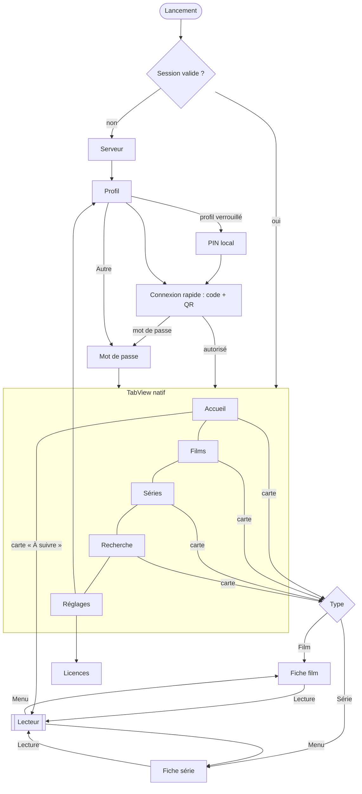

# Plan UI/UX tvOS — Phase 3 (révision KISS / HIG)

Statut : proposition révisée, à valider par Antonin avant le premier commit de code UI.
Périmètre : tvOS 17+, SwiftUI pur. iOS / iPadOS ensuite (§11). Maquettes : `docs/design/mockups/index.html`
(11 écrans, 1920×1080, autonomes). Contexte produit et phases : `.claude/plans/reboot-appletv-swift-natif.md` du dépôt
`jellyfuse`. Ce plan consomme le player (Phase 1) et le cœur Jellyfin (Phase 2), il ne les redessine pas.

Sommaire : 0 recherche et ce qu'elle a changé · 1 principes · 2 identité · 3 tokens · 4 architecture · 5 navigation ·
6 écrans · 7 composants · 8 règles de focus · 9 données Jellyfin · 10 états · 11 iOS · 12 hors périmètre ·
13 ordre de construction · 14 questions ouvertes.

---

## 0. Recherche et ce qu'elle a changé

### 0.1 Sources

Apple Human Interface Guidelines (pages lues via l'endpoint JSON de developer.apple.com, résumées par un modèle :
la substance et les chiffres sont fidèles, les formulations sont paraphrasées, à recouper sur la page avant toute citation
littérale) :

1. [Focus and selection](https://developer.apple.com/design/human-interface-guidelines/focus-and-selection) : s'appuyer sur
   les effets système (« custom effects only if absolutely necessary »), ne pas déplacer le focus sans action de
   l'utilisateur, tout élément doit être atteignable au focus, parallaxe, agrandir sans « crowd » l'interface, cinq états
   (non focalisé, focalisé, *highlighted*, sélectionné, indisponible), pas de pointeur.
2. [Tab bars](https://developer.apple.com/design/human-interface-guidelines/tab-bars) : sur tvOS la barre est en haut, hauteur
   68 pt et bord haut à 46 pt (non modifiables) ; **Menu ramène toujours le focus sur la barre** ; elle peut défiler hors
   écran quand l'onglet n'a qu'une vue principale ; navigation, pas actions ; ne pas masquer ni désactiver un onglet
   (expliquer s'il est vide) ; libellés d'un mot ; moins d'onglets = plus simple ; boutons-icônes (réglages, recherche)
   possibles dans la barre.
3. [Layout](https://developer.apple.com/design/human-interface-guidelines/layout) : zone sûre **60 pt haut/bas, 80 pt
   côtés** ; grilles tvOS : 6 colonnes = items de 260 pt, écart 40 pt, **espacement vertical minimum 100 pt** ; 5 col. 320 pt,
   4 col. 410 pt, 3 col. 560 pt ; laisser du jeu autour de l'élément focalisé ; contenu partiellement hors champ de même
   largeur de chaque côté.
4. [Typography](https://developer.apple.com/design/human-interface-guidelines/typography) : styles tvOS (Title 1 76 Medium,
   Title 2 57, Title 3 48, Headline 38, Subtitle 1 38, Callout 31, Body 29, Caption 1 25, Caption 2 23), texte par défaut
   29 pt, **minimum 23 pt**, emphase = Bold, éviter Ultralight/Thin/Light, SF Pro (ou New York).
5. [Playing video](https://developer.apple.com/design/human-interface-guidelines/playing-video) : utiliser le lecteur
   système ; si lecteur custom, **« référencer le comportement du lecteur système »** car une divergence légère frustre ;
   contrôles de transport + onglets de contenu (Infos, Épisodes, Chapitres) « un pas ou deux » ; **reprendre
   automatiquement sans demander confirmation** ; pas d'écran-barrière avant la lecture ; loader noir + spinner seulement
   après 2 s ; à la sortie, **afficher la fiche du contenu avec option de reprise** ; overlays courts, discrets, SDR
   (rétention d'image).
6. [Siri Remote](https://developer.apple.com/design/human-interface-guidelines/remotes) : balayer = focus ; clic = activer ;
   **Retour = parent dans la hiérarchie** (Home Apple TV au sommet) ; Lecture/Pause = lire/mettre en pause ; ne pas
   redéfinir les boutons standard hors jeu ; ne pas réagir aux taps involontaires ; appui sur le pavé avant balayage =
   mode scrub.
7. [Collections](https://developer.apple.com/design/human-interface-guidelines/collections) : préférer la ligne/grille
   standard, éviter les mises en page custom, marge autour des images pour voir l'effet de focus.
8. [Top Shelf](https://developer.apple.com/design/human-interface-guidelines/top-shelf) (Phase 4) : mettre en avant du
   contenu **nouveau ou à reprendre**, pas ce qui a déjà été vu ; carrousel avec bouton de lecture + « plus d'infos » ;
   image statique de repli 2320×720 ; rangée : affiche 2:3 404×608, 16:9 908×512.

Sources UX TV :
9. [Smashing Magazine, « Designing For TV » (2025)](https://www.smashingmagazine.com/2025/09/designing-tv-principles-patterns-practical-guidance/) :
   étagères horizontales, dernier élément qui dépasse du bord, haut/bas = changer de groupe et gauche/droite = changer
   d'élément, focus lisible de loin (scale, inversion, bordure, seuls ou combinés), palette discrète avec contraste
   réservé au focus, texte de base à partir de 24 px, 5-6 tailles de texte au plus, **appui long = menu contextuel**,
   lecteur : l'interface s'efface pour laisser le contenu, la TV favorise la navigation latérale (point de vue
   contraire à celui d'Apple sur tvOS, qui est ici prioritaire).
10. Recherche web « 10-foot UI » (Amazon Fire TV UX guidelines, Edenspiekermann, Microsoft « Designing for Xbox and TV »,
    UI/UX Atlas) : **non lues en entier**, seulement leurs résumés de résultats : écrans simples et peu denses, focus
    visible « de 10 pieds », navigation prévisible, pas de bouton Retour dans l'UI (c'est la télécommande). Cités pour
    mémoire, aucune décision ne repose sur eux seuls.

Limite : aucune source lue ne détaille la conception du billboard de Netflix ; les choix de billboard viennent des HIG
(Top Shelf, focus) et de Smashing, pas d'une analyse Netflix.

### 0.2 Avant → après

| Sujet | Avant (v1 du plan) | Après (HIG + KISS) | Raison |
|---|---|---|---|
| Navigation | barre custom (wordmark, 6 onglets, avatar) | **`TabView` natif** : Accueil, Films, Séries, Recherche, Réglages | HIG tab bars : barre système, Menu y ramène le focus, ne pas masquer d'onglet ; moins de code ; accessibilité gratuite |
| Marges | 90 pt côtés | **80 pt** côtés, 60 haut/bas | HIG layout |
| Grille / cartes | affiche 250×375, écart vertical 56 | **260×390, écart 40, vertical ≥ 100** ; paysage 410×231 | HIG layout (6 colonnes = 260) |
| Focus | liseré blanc 5 pt + lueur violette + scale 1,12 | **effet système** (scale ≈ 1,1, ombre, parallaxe, légère hausse de luminosité) | HIG focus : effets système, custom seulement si indispensable |
| Typo | 104 Heavy, 66, 57 custom | **styles tvOS uniquement** (Title 1 76 Bold pour les titres, Body 29, Callout 31, Caption 25/23) ; jamais Heavy/Light | HIG typography |
| Billboard | 6 éléments, rotation 8 s, pagination, tag « À LA UNE », badges 4K/HDR, 3 boutons | **1 élément statique** : titre, 1 ligne de méta, 2 lignes de synopsis, **Lecture + Ma liste** | HIG : pas de changement sans action ; KISS |
| Accueil | Reprendre + À suivre + Récents + Reco + Ma liste | **« À suivre »** (reprises puis prochains épisodes, fusionnés) + Récents par bibliothèque + Ma liste | Apple TV app : un seul « Up Next » ; reco abandonnée (Jellyfin n'a pas de vrai moteur) |
| Fiche film | méta + 4 badges + crédits à droite + 4 boutons + 3 sélecteurs (version, audio, sous-titres) + Détails | **1 ligne de méta, 3 boutons** (Lecture/Reprendre, Ma liste, Vu), Distribution ; audio/sous-titres **dans le lecteur** ; version proposée seulement s'il y en a plusieurs | « a-t-on besoin de ça à 3 m ? » ; HIG playing video (reprise sans question) |
| Fiche série | synopsis déplié sur carte, 5 chips, 4 boutons | Reprendre + Ma liste, **chips de saisons**, épisodes (titre + durée) ; synopsis complet en appui long | pas de changement de mise en page au focus |
| Lecteur | OSD à 6 boutons, heure de fin, segments en surbrillance, panneau latéral à 2 colonnes | **calqué sur le lecteur système** : titre, 2 icônes (sous-titres, audio), barre, temps ; bas = onglets de contenu **Infos · Audio · Sous-titres · Chapitres** (liste unique) ; « Passer l'intro » ; épisode suivant en fin | HIG playing video : référencer le lecteur système |
| Bibliothèque | 2 rangées de chips, bouton Non vus, rail A-Z, sous-titre, badges | **Titre + un bouton « Filtres et tri »** (panneau : tri, genres, Non vus, Favoris, années, **« Aller à la lettre »**) ; grille seule | moins de chrome ; HIG collections : grille standard |
| Recherche | chips de types, aide Siri, récents | champ + clavier système, **résultats groupés** ; pas de chips | `.searchable` natif |
| Connexion | 2 panneaux, 3 étapes, expiration, mosaïque | **un code, une phrase, un QR**, 2 boutons | KISS |
| Profils | 3 chips, « Gérer » | avatars + « Changer de serveur » en lien | KISS |
| Réglages | barre latérale 7 sections, ~25 lignes | **une liste groupée** : Compte, Lecture (5 lignes), À propos | `Form` natif ; on retire ce qui n'a pas de besoin prouvé |
| Onglets | + Ma liste, + Collections, avatar | **Ma liste = shelf d'accueil + filtre « Favoris »** ; Collections = filtre de Films ; profil dans Réglages | HIG : moins d'onglets |
| Transition carte → fiche | zoom envisagé | fondu avec backdrop conservé | `NavigationTransition.zoom` incertain sur tvOS |
| Questions ouvertes | 10 | **6** (§14) | tranchées par les HIG : barre de nav, rotation, onglet Ma liste, note affichée |

Identité violet/rose **inchangée** (aucune raison HIG de la modifier). Elle est en revanche **plus rare** : elle ne
sert plus qu'au wordmark, à la barre de progression et à la coche de sélection.

## 1. Principes

1. **Natif d'abord.** Si tvOS fournit le composant (`TabView`, `.searchable`, `Form`/`List`, `contextMenu`, `.card`,
   `confirmationDialog`), on l'utilise et on ne le redessine que pour la marque (couleurs, typo système). Moins de code,
   comportements attendus, accessibilité incluse.
2. **À 3 m, avec une télécommande, en a-t-on besoin LÀ ?** Chaque élément doit passer ce test ; sinon il va dans un
   appui long, un panneau, ou disparaît.
3. **Le contenu est l'interface.** Affiches et backdrops portent l'écran ; une ligne de méta, pas de badges (les infos
   techniques vivent dans l'onglet Infos du lecteur).
4. **Le focus est le design.** Chaque écran est un graphe de focus : défaut, sorties, Menu, Lecture/Pause (§6, §8).
5. **Reprendre sans friction.** Lecture = reprise automatique, sans question (HIG). « Depuis le début » est dans
   l'appui long.
6. **Rien de bloquant.** Squelettes à la forme finale, cache d'abord, jamais de spinner plein écran avant 2 s.
7. **Complet côté Jellyfin, honnête côté limites.** Tout le périmètre d'un client vidéo, mais derrière des écrans
   sobres ; §12 liste ce qui n'y est pas et pourquoi.

## 2. Identité (inchangée, plus discrète)

- **Wordmark** `jellyfuse` : étincelle à quatre branches en dégradé violet → rose + `jelly` blanc + `fuse` en dégradé,
  ExtraBold. Visible sur : lancement, connexion, profils, À propos. **Absent de la barre d'onglets** (système).
- **Accent** « Fuse Violet » `#8A6CFF`, étincelle `#FF5C8A`. Dégradé `#8A6CFF → #C65BDB → #FF5C8A` réservé à la
  progression de lecture et au wordmark ; l'accent plein sert à la coche de sélection.
- **Ton** : sobre, cinéma. Fond `#07070B`.

## 3. Système visuel

Tokens dans `DesignSystem` (namespace `Design`, §4). Aucun nombre brut dans une vue (règle d'Oisillon).

### 3.1 Palette (thème sombre unique)

| Token | Hex | Usage |
|---|---|---|
| `canvas` | `#07070B` | fond |
| `surface` | `#101018` | rangées de réglages (à 6 % blanc sur `canvas`) |
| `overlay` | `#181824` (82 %) sous flou | panneaux du lecteur |
| `textPrimary` | `#F4F4F8` | titres |
| `textSecondary` | `#A6A6B8` | synopsis, méta (8,3:1 sur `canvas`) |
| `textTertiary` | `#6E6E82` | légendes secondaires ≥ 25 pt, jamais une info essentielle (4,0:1) |
| `accent` | `#8A6CFF` | sélection (4,9:1) |
| `accentGradient` | violet → rose | progression, wordmark |
| `success` | `#3DDC97` | vu, interrupteur actif |
| `warning` | `#FFB84D` | note ★ |
| `danger` | `#FF5A5F` | déconnexion, erreur |

Trois scrims fixes sur les backdrops (`Design.Scrim`) : gauche (lisibilité du texte), bas (fondu vers les shelves), haut.
Aucun texte posé sans scrim.

### 3.2 Typographie : styles tvOS uniquement

| Rôle | Style tvOS | Taille | Usage |
|---|---|---|---|
| `title` | Title 1 (Bold pour l'emphase) | 76 | titre de fiche, de billboard, d'écran |
| `sectionTitle` | Headline | 38 | en-tête de shelf |
| `callout` | Callout | 31 | boutons, onglets internes, lignes de réglages |
| `body` | Body | 29 | méta, synopsis, légendes de carte |
| `caption` | Caption 1 | 25 | sous-légendes, aides |
| `caption2` | Caption 2 | 23 | plancher |

Pas de Heavy ni de Light ; pas de taille hors styles, sauf les chiffres du code Quick Connect (`Design.Typography.code`,
92 pt Bold). Quand le serveur fournit un logo transparent (`ImageType.logo`), la fiche peut l'utiliser à la place du
titre texte (v1.1).

### 3.3 Grille

- 1920×1080 pt, **zone sûre 60 pt haut/bas, 80 pt côtés**.
- **Affiche 260×390 (6 colonnes), écart horizontal 40, espacement vertical ≥ 100** ; **paysage 410×231 (4 colonnes)** ;
  disque personne 150 ; avatar de profil 230.
- Une shelf laisse passer la carte suivante au bord (peek). Chaque shelf réserve 40 pt de marge haute et basse pour
  l'effet de focus (`scrollClipDisabled()` + padding).
- Échelle `Design.Spacing` : 8 · 16 · 24 · 40 · 80 ; alias `screenMargin` 80, `shelfGap` 40, `gridRowGap` 100.

### 3.4 Focus

On s'appuie sur l'effet système : `.buttonStyle(.card)` pour les cartes (scale, ombre, parallaxe des images à calques),
style de bouton système pour les boutons (inversion blanche). On ajoute seulement :
- une légère hausse de luminosité de l'image focalisée (lisibilité sur fond très sombre) ;
- la légende qui passe en `textPrimary` plein.

Pas de liseré ni de lueur de marque. États (HIG) : non focalisé, focalisé, *highlighted* (inversion brève au clic),
sélectionné (chip actif en blanc, coche accent), indisponible. Reduce Motion : on retire le scale animé, il ne reste que
l'inversion/ombre.

## 4. Architecture (alignée sur sillon et oisillon)

Études : `~/projects/sillon` (Swift 6, XcodeGen, `SillonKit`, `AppModel` main actor, vues minces, façade `actor
JellyfinClient`) et Oisillon (dépôt `~/projects/poste`, `~/projects/oisillon` n'existe pas ; `Design` à sous-espaces,
« aucun nombre brut dans une vue », `docs/design/`, maquettes HTML).

| Règle | Origine | Ici |
|---|---|---|
| Logique dans le package, vues minces | sillon, oisillon | `Packages/JellyKit` pour tout ce qui se teste ; `Apps/Jellyfuse` ne parle jamais au réseau |
| `AppModel` `@MainActor @Observable` + `report(_:otherwise:)` | sillon | session, erreurs, réseau : un bandeau pour le réseau, une alerte pour le reste |
| Tokens `Design` nommés | oisillon | `DesignSystem/Design.swift` |
| Tests swift-testing, réseau par `URLProtocol` | les deux | logique des modèles d'écran et du DesignSystem sans simulateur |
| Français = clé, traductions en `.xcstrings` | les deux | `String(localized:)` |
| Swift 6 strict | les deux | idem |
| Arguments de lancement Debug | sillon | `-JellyfuseServer <url>`, `-JellyfuseOpen detail:<id>` |

### 4.1 Découpage

```
Packages/JellyKit/Sources/
├── DesignSystem/     # NOUVEAU. SwiftUI seul, zéro dépendance Jellyfin
│   ├── Design.swift                    # Palette, Typography, Spacing, Size, Scrim, Motion
│   ├── Artwork.swift, Badge.swift …    # fondations
│   ├── Cards/ (PosterCard, LandscapeCard, PersonCard, ProfileAvatar)
│   ├── Layout/ (Shelf, Billboard, BackdropView, PosterGrid, DetailHeader)
│   ├── Player/ (PlayerOSD, Scrubber, TrickplayBubble, ContentTabs, SkipButton, UpNextCard)
│   ├── Forms/ (SettingsRow, PinPad, QuickConnectCode)
│   └── Models/ (PosterModel, EpisodeModel, OSDModel…)    # valeurs d'affichage
├── LibraryKit/ · PlayerCore/ · PlaybackEngine/ (Phase 2) · AppModel/ (Phase 2)
Apps/Jellyfuse/
├── JellyfuseApp.swift, RootView.swift (TabView), AppModel.swift
├── Presentation/   # LibraryKit → modèles d'affichage (mappers purs, testés)
└── Features/       # Auth/ Home/ Detail/ Library/ Search/ Player/ Settings/ : View mince + XxxModel @Observable
```

`DesignSystem` ne connaît ni `LibraryKit` ni le SDK : ses vues reçoivent des valeurs `Sendable, Equatable, Identifiable`
et émettent des callbacks (props-in, callbacks-out) :

```swift
public struct PosterModel: Sendable, Equatable, Identifiable {
    public let id: String; public let title: String
    public let image: ArtworkSource; public let progress: Double?; public let isWatched: Bool
}
public struct PosterCard: View {
    public init(_ model: PosterModel, onSelect: @escaping () -> Void)
}
```

### 4.2 État et données
- Un `XxxModel` `@Observable` par écran, état `Loadable<T>` (`idle | loading | loaded | failed`), jamais de DTO brut.
- Cache disque de l'Accueil seulement (dernier résultat par shelf, clé serveur + utilisateur, comme `libraryOwner` de
  sillon). Images : Nuke avec cache disque. Pas de store généralisé.
- Websocket (`socketSession`) : `UserDataChanged` rafraîchit « À suivre » ; `LibraryChanged` invalide « Récents ».
- Mutations (vu, ma liste) optimistes avec rollback + `report`.

## 5. Navigation



- **Onglets** (`TabView` natif, 5 maximum) : `Accueil`, `Films`, `Séries`, `Recherche`, `Réglages`. Une bibliothèque
  vidéo supplémentaire (vidéos personnelles, mixte) ajoute un onglet seulement si elle existe. Musique, livres, photos :
  masqués (Sillon couvre la musique). Collections : filtre de Films. Ma liste : shelf d'accueil + filtre « Favoris ».
- **Menu** : sur n'importe quel écran racine, premier appui = focus sur la barre d'onglets (comportement système) ;
  sur la barre = Home Apple TV. Dans une fiche : pop vers l'écran parent. Dans le lecteur : voir §6.7.
- Deep links : `jellyfuse://item/<id>`, `jellyfuse://play/<id>` (Top Shelf en Phase 4).

## 6. Écrans

**F0** = focus par défaut · **Menu** = bouton Retour · **▶︎⏸** = Lecture/Pause · **LP** = appui long (menu contextuel).

### 6.1 Auth (`login.html`, `profiles.html`)
- **Serveur** : liste « Détectés » (`JellyfinClient.discover`, UDP 7359) + « Récents » + « Saisir une adresse »
  (champ système, saisie depuis l'iPhone offerte par tvOS). Validation par `getPublicSystemInfo` (nom + version).
  F0 : dernier serveur. Menu : retour à l'app si une session existe, sinon Home Apple TV.
- **Profil** : avatars (`getPublicUsers`) + « Autre ». Cadenas = **PIN local** (4 chiffres, Keychain : protège l'app sur
  cet Apple TV, pas le compte, cf. Q2). F0 : dernier profil. LP : oublier le profil. Pas de « Gérer les profils » :
  l'oubli est dans l'appui long et dans Réglages.
- **Connexion rapide** : code à 6 chiffres, une phrase, QR vers `<serveur>/web/#/quickconnect`, « En attente… ». F0 :
  « Utiliser un mot de passe ». Flux : `getQuickConnectEnabled` → `initiateQuickConnect` → poll 5 s → session
  (`QuickConnect.connect` du SDK). Expiration : nouveau code, focus inchangé. Quick Connect désactivé : l'écran est
  sauté. Menu : retour au profil.
- **Mot de passe** : nom (pré-rempli) + mot de passe + « Se connecter » (`authenticateUserByName`). Mot de passe vide
  accepté.

### 6.2 Accueil (`home.html`)
- **Barre d'onglets** native. **Billboard** : **un** élément (la première reprise, sinon un titre non vu tiré au hasard
  parmi ceux qui ont un backdrop, fixé pour la session), plein écran sous scrims ; titre, une ligne (★ note · année ·
  durée), synopsis 2 lignes, boutons **Lecture / Reprendre** et **Ma liste**. Pas de rotation, pas de pagination, pas de
  badges.
- **Shelves** : (1) **À suivre** (paysage, progression, « 28 min restantes ») = reprises puis prochains épisodes,
  dédoublonnés par série ; (2) **Récents** par bibliothèque (affiches) ; (3) **Ma liste** si non vide. Les shelves
  vides sont absentes.
- **F0** : « Lecture » du billboard ; bas : première carte (ou la carte mémorisée). Le billboard ne change jamais au
  focus d'une carte. **Menu** : focus vers la barre d'onglets (système). **▶︎⏸** sur une carte : lecture (reprise).
  **LP** : Marquer vu/non vu, Ma liste, Aller à la série, Depuis le début.
- **États** : squelettes (billboard flou + une shelf) ; cache instantané ; hors ligne = bandeau.

### 6.3 Fiche film (`detail-movie.html`)
- Backdrop + scrims ; colonne gauche : titre, **une ligne** (★ · année · durée · genres · classification), synopsis (3
  lignes), **trois boutons** : **Lecture / Reprendre · 1 h 12** (primaire), **Ma liste** (icône), **Vu** (icône).
  Dessous : **Distribution** (disques), puis **Similaires**, **Extras** (si présents).
- **Pas** de sélecteurs d'audio/sous-titres ici : ils sont dans le lecteur (§6.7) et suivent la mémorisation + les
  préférences (§9.3). Si le fichier existe en plusieurs versions (`MediaSources` > 1), un bouton « Version » apparaît ;
  sinon il n'existe pas. « Depuis le début », « Informations » : appui long sur le bouton primaire.
- **F0** : bouton primaire. **Menu** : retour. **▶︎⏸** : lecture. **LP** sur un acteur : sa fiche.
- Transition : fondu, même backdrop (pas de zoom, cf. Q5).

### 6.4 Fiche série (`detail-series.html`)
- Tête identique ; boutons **Reprendre S2 · E5** (ou Lecture S1 · E1) et **Ma liste**. **Chips de saisons** ; **rangée
  d'épisodes** (carte paysage, « 5. Titre », durée, progression, coche si vu). Pré-défilée sur l'épisode à suivre.
- **Pas** de synopsis déplié ni de mise en page qui bouge au focus : **LP** (ou Sélection prolongée) sur un épisode =
  fiche modale (synopsis, date, infos fichier) + « Depuis le début ». Ouvrir un épisode trouvé en recherche = ouvrir la
  série focalisée sur lui (pas d'écran épisode séparé).
- **F0** : bouton primaire. Bas : chip de saison active, puis l'épisode à suivre. **Extras** : chip supplémentaire
  seulement si `getSpecialFeatures` n'est pas vide.

### 6.5 Bibliothèque (`library.html`)
- Titre (« Films ») + **un seul bouton « Filtres et tri »** (affiche le tri courant). Grille 6 colonnes (260 pt, 40 pt,
  ≥ 100 pt), affiches avec coche « vu » et progression ; rien d'autre.
- **Panneau « Filtres et tri »** : Tri (Titre, Date d'ajout, Date de sortie, Note, Durée, Aléatoire), Genres, Non vus,
  Favoris, Années, Classifications, **« Aller à la lettre »** (rangée A-Z : saut par `nameStartsWithOrGreater`) et, pour
  Films, « Collections ». Un seul panneau remplace les deux rangées de chips et le rail.
- **F0** : première affiche (mémorisée au retour). Haut depuis la première ligne : le bouton, puis la barre d'onglets.
  Pagination par pages de 60, préchargement à 2 lignes de la fin. **LP** : vu, Ma liste, Informations.
- **États** : filtre sans résultat (« Effacer les filtres »), bibliothèque vide, erreur de page (« Réessayer »).
- Collection ouverte / filmographie d'une personne : même grille avec titre de la collection ou de la personne.

### 6.6 Recherche (`search.html`)
`.searchable` natif (clavier système, dictée Siri, saisie depuis l'iPhone, suggestions). Résultats **groupés en
shelves** (Films, Séries, puis Épisodes et Personnes s'ils ont des résultats), pas de chips. Dès 2 caractères, 300 ms de
pause, réponse tardive abandonnée (règle de `CatalogSearch` de sillon). Avant la frappe : Récents ajoutés. F0 : le
clavier. Menu : efface la requête puis focus sur la barre.

### 6.7 Lecteur (`player-osd.html`, `player-tracks.html`)
**Principe HIG** : mpv remplace `AVPlayerViewController`, donc on **reproduit le comportement du lecteur système** pour
que les gestes habituels continuent de marcher. Mêmes conventions : barre en bas, titre + icônes au-dessus, onglets de
contenu vers le bas, Menu = sortie.

| État | Contenu | Commandes |
|---|---|---|
| `hidden` | vidéo seule | **Sélection** : afficher la barre (et basculer pause) ; **Gauche/droite** : −10 s / +30 s ; **Bas** : onglets de contenu ; **▶︎⏸** : pause/lecture ; **Menu** : quitter |
| `transport` | titre (série · saison/épisode), **2 icônes** (sous-titres, audio), barre (tampon, chapitres), temps écoulé / restant | masquée après 5 s ; glisser sur le pavé = `scrubbing` ; **Menu** : `hidden` |
| `scrubbing` | barre + **bulle trickplay** (vignette, horodatage, chapitre) | clic gauche/droit ou glisser ; **Sélection** valide ; **Menu** annule |
| `tabs` | panneau avec onglets **Infos · Audio · Sous-titres · Chapitres** (une seule liste à la fois) | haut/bas = choix, **Sélection applique immédiatement et mémorise** ; **Menu** ferme |
| `skip` | bouton « Passer l'intro / le récapitulatif / le générique » 8 s, **prend le focus à l'apparition** | **Sélection** saute ; sans action, disparaît ; en mode « passer automatiquement » : saut + court message |
| `upNext` | carte « Épisode suivant » à l'entrée du générique de fin ; compte à rebours 10 s si lecture auto | **Sélection** : lancer ; **Menu** : annuler |

- **Retiré** de la v1 du plan : boutons Précédent / Suivant dans la barre (l'épisode suivant est proposé en fin et dans
  l'onglet Chapitres/Épisodes plus tard), heure de fin, ticks de segments, deux colonnes de pistes.
- **Reprise** : jamais de question (HIG). **Sortie** : Menu ferme le lecteur et **ramène à la fiche du contenu**
  (HIG), focus sur le bouton Lecture (« Reprendre » à jour). Fin de film : fiche ; fin de série : fiche série.
- **Erreurs** : « Lecture impossible » avec Réessayer / Autre version / Retour. Mise en mémoire tampon > 2 s : écran
  noir + spinner centré, rien autour (HIG).
- **Overlays courts et discrets** (rétention d'image) : « Passer l'intro » et « Épisode suivant » sont translucides,
  petits, temporaires.
- **Risque** : le scrub continu au pavé tactile demande un pont UIKit (`UIPanGestureRecognizer`,
  `allowedTouchTypes = [.indirect]`) car SwiftUI pur ne l'expose pas ; le clic gauche/droit (`onMoveCommand`) n'en a pas
  besoin. Premier spike du lot 3.4a. Reporting (start/progress/stopped) : Phase 2.

### 6.8 Réglages (`settings.html`, `licenses.html`)
Une **liste groupée** native (`Form`/`List`), sans barre latérale. F0 : première ligne. Menu : focus sur la barre.
- **Compte** : « Changer d'utilisateur » (ouvre Profil ; contient « Se déconnecter » et « Oublier ce profil »).
- **Lecture** : Lire l'épisode suivant automatiquement · Passer les intros automatiquement · Débit maximal (Automatique,
  puis paliers) · Langue audio · Sous-titres (Automatique / Forcés / Toujours / Aucun).
- **À propos** : **Licences** (liste mpv, FFmpeg, libplacebo, libass, MoltenVK, dav1d, FreeType/HarfBuzz/FriBidi, SDK ;
  texte intégral en feuille ; introduction MIT + lien du code source pour la recompilation, obligation LGPL §6), version.
- Retiré de la v1 du plan (aucun besoin prouvé) : Apparence, qualité détaillée, taille/couleur des sous-titres,
  serveurs (la liste des serveurs vit dans l'écran Serveur), journaux.
Valeurs **par utilisateur** lues du serveur au départ (`UserConfiguration`, §9.3) ; débit et automatismes en local.
La CI échoue si un artefact `-GPL` entre dans le graphe (plan de reboot).

### 6.9 États transverses
Serveur injoignable (plein écran sans cache, bandeau sinon ; F0 Réessayer) · 401 (retour au profil avec message) ·
vide (bibliothèque, Ma liste, recherche) avec la prochaine action · lancement : fond `canvas` + étincelle, pas
d'écran marketing.

## 7. Composants DesignSystem

Purs (props-in, callbacks-out), un composant natif quand il existe.

| Besoin | Composant | Esquisse | Natif ? |
|---|---|---|---|
| Onglets | — | `TabView` | **natif** |
| Recherche | — | `.searchable` | **natif** |
| Réglages | `SettingsRow` | `SettingsRow(title:, accessory: .toggle(Binding)/.value(String)/.chevron)` dans un `Form` | liste native, ligne custom minimale |
| Confirmations, choix | — | `confirmationDialog`, `Menu`/`Picker` | **natif** |
| Menu contextuel (LP) | — | `.contextMenu` | **natif** |
| Cartes | `PosterCard`, `LandscapeCard` | `(_ model:, onSelect:)` ; `.buttonStyle(.card)` | effet de focus natif |
| Personne, profil | `PersonCard`, `ProfileAvatar` | `(_ model:, isLocked:, onSelect:)` | — |
| Rangée | `Shelf` | `Shelf(title:, items:, card:)` : `ScrollView` + `LazyHStack`, `focusSection`, `scrollClipDisabled` | — |
| Billboard | `Billboard` | `Billboard(_ model:, primaryLabel:, onPlay:, onToggleList:)` : backdrop + scrims + texte + 2 boutons | — |
| Fond | `BackdropView` | `BackdropView(_ source:, scrim:)` | — |
| Tête de fiche | `DetailHeader` | `DetailHeader(title:, meta:, overview:, actions: @ViewBuilder)` | — |
| Grille | `PosterGrid` | `PosterGrid(items:, onSelect:, onReachEnd:)` : 6 colonnes fixes | `LazyVGrid` |
| Chips de saison | `FuseChip` | `FuseChip(_ title:, isSelected:, action:)` | — |
| Panneau de choix | `OptionPanel` | `OptionPanel(title:, options:, selection:, onSelect:)` (tri, débit, langues, pistes) | — |
| Images | `Artwork` | `Artwork(_ source:, aspect:)` : Nuke + blurhash + dégradé de repli | — |
| Chargement | `Skeleton`, `EmptyState`, `Banner` | formes statiques ; état vide ; bandeau réseau unique | — |
| Lecteur | `PlayerOSD`, `Scrubber`, `TrickplayBubble`, `ContentTabs`, `SkipButton`, `UpNextCard` | `PlayerOSD(state:, model:, handlers:)` ne connaît pas mpv ; tuile trickplay calculée par `TrickplaySheet.tile(at:)` (testé) | — |
| Auth | `QuickConnectCode`, `QRCodeView`, `PinPad` | code en cases ; QR par `CIQRCodeGenerator` ; clavier + chiffres de la télécommande | — |

Supprimés du plan précédent : `TopNav`, `ChipRow`, `LetterRail`, `EpisodeCard` (une `LandscapeCard` suffit), `EpisodeInfoSheet`
(un `OptionPanel`/feuille suffit), `InfoPanel` et `ChapterStrip` (deux onglets de `ContentTabs`), `ServerRow` (une
`SettingsRow`), `MetaLine`, `GradientText` (le wordmark est un asset).

## 8. Règles de focus transverses

1. Chaque bloc est un `focusSection()` (billboard, shelf, boutons, grille).
2. Focus par défaut par `@Namespace` + `prefersDefaultFocus`, jamais par temporisation.
3. **Restauration** : retour d'une fiche = même carte focalisée, même défilement (ID mémorisé dans le modèle d'écran).
4. **Menu** : jamais redéfini sur les écrans racine (le système ramène à la barre puis à l'Apple TV) ; panneaux et
   dialogues ferment leur panneau ; lecteur : `hidden` → sortie vers la fiche.
5. **Pas de changement de contenu au focus** (billboard fixe, pas de synopsis déplié) : HIG « ne pas déplacer le focus
   sans action » et mises en page stables.
6. **▶︎⏸** lance sur une carte lisible, bascule dans le lecteur, rien ailleurs. **LP** = `contextMenu` sur toutes les
   cartes lisibles.
7. Ignorer les taps involontaires sur le pavé pendant la lecture (HIG remote) : seuls clic, balayage et boutons agissent.
8. Pas de `scrollTo` animé pendant le déplacement du focus ; `scrollPosition(id:)`.
9. Accessibilité : `accessibilityLabel` complet par carte (« Nocturne, film, 2025, repris à 62 % ») ; scrubber
   `adjustable`.
10. Tests : règles pures (mémoire de focus, lettre → index, tuile trickplay) en swift-testing ; parcours critiques en
    XCUITest (`XCUIRemote`) : Accueil → fiche → lecture → Menu → fiche, focus restauré.

## 9. Données : écran → Jellyfin

Tout passe par `jellyfin-sdk-swift` via la façade `JellyfinClient` (règle dure du plan de reboot). Noms vérifiés dans
`Sources/Paths` du SDK.

| Écran | Ressource SDK | Paramètres clés |
|---|---|---|
| Serveur | `JellyfinClient.discover`, `getPublicSystemInfo` | UDP 7359 ; URL saisie |
| Profil | `getPublicUsers`, `getUserImage` | — |
| Connexion rapide | `getQuickConnectEnabled`, `initiateQuickConnect`, `getQuickConnectState`, `authenticateWithQuickConnect` | poll 5 s |
| Mot de passe | `authenticateUserByName` | — |
| Onglets | `getUserViews` | `collectionType` → onglets |
| Accueil · À suivre | `getResumeItems` + `getNextUp` | `mediaTypes [.video]`, `enableRewatching false`, fusion et dédoublonnage par série |
| Accueil · Récents | `getLatestMedia` | `parentID`, `limit 20` |
| Accueil · billboard | première reprise, sinon `getItems` | `isUnplayed`, `sortBy random`, `imageTypes [.backdrop]`, `limit 12` |
| Accueil · Ma liste | `getItems` | `filters [.isFavorite]` |
| Images | `getItemImage` | Primary, Backdrop, Thumb, Chapter ; `tag`, `maxWidth` ; `ImageBlurHashes` |
| Fiche | `getItem` | `fields [.overview, .genres, .people, .mediaSources, .mediaStreams, .chapters, .trickplay]` |
| Fiche · Similaires / Extras | `getSimilarItems`, `getSpecialFeatures` | `limit 12` |
| Série | `getSeasons`, `getEpisodes` | `isMissing false`, `seasonID`, `startItemID` |
| Bibliothèque | `getItems` | `parentID`, `sortBy`, `filters`, `genres`, `years`, `startIndex/limit 60`, `nameStartsWithOrGreater`, total |
| Filtres | `getGenres`, `getQueryFilters` | `parentID` |
| Collection / personne | `getItems` | `parentID` du BoxSet ; `personIDs` |
| Recherche | `getSearchHints`, `getItems(ids:)` | `searchTerm`, `limit 12` par type |
| Mutations | `markFavoriteItem`/`unmarkFavoriteItem`, `markPlayedItem`/`markUnplayedItem` | — |
| Lecture | `getPostedPlaybackInfo`, `reportPlaybackStart`/`Progress`/`Stopped` | profil d'appareil tvOS ; `MediaSourceId`, `PlayMethod`, `CanSeek` (Phase 2) |
| Lecteur · chapitres | champ `chapters` + `getItemImage(.chapter)` | repères + onglet Chapitres |
| Lecteur · trickplay | champ `trickplay` + `getTrickplayTileImage` | largeur ≥ 320 la plus proche |
| Lecteur · segments | `getItemSegments` (Jellyfin ≥ 10.10) | `Intro`, `Recap`, `Outro` |
| Lecteur · pistes / infos | `MediaStreams` du `MediaSource` | mapping sid group-aware (lessons-learned) |
| Réglages | `getCurrentUser` (`UserDto.configuration`) | `audioLanguagePreference`, `subtitleLanguagePreference`, `subtitleMode`, `rememberAudioSelections`… |
| Temps réel | websocket | `UserDataChanged`, `LibraryChanged` |

Abandonnés par rapport à la v1 du plan : `getMovieRecommendations`/`getSuggestions` (plus de shelf de recommandation),
`getDisplayPreferences` (plus de réglage synchronisé), `getPersons` (la recherche de personnes passe par
`getSearchHints`).

**Préférences (ordre de priorité)** : choix explicite dans le lecteur → mémorisation par série → préférences de
l'utilisateur serveur → réglages Jellyfuse → piste par défaut du fichier.
**Images** : affiche `maxWidth 520` (2×), paysage 820, backdrop 2560, disque 300 ; URL avec `tag` ; flou blurhash.

## 10. États

Squelettes statiques à la forme finale ; cache d'abord, revalidation silencieuse ; hors ligne = un `Banner` ; 401 =
retour au profil ; vide = `EmptyState` + action ; erreur de page = « Réessayer » en bout de shelf ; titres à 2 lignes
maximum ; aucun `try?` qui avale une erreur visible (tout passe par `AppModel.report`).

## 11. iOS / iPadOS (plus tard)

Le `DesignSystem` tvOS n'est pas partagé ; la cible iOS aura ses composants tactiles. Partagés : `LibraryKit`,
`PlaybackEngine`, `AppModel`, modèles d'affichage, mappers, tokens de palette.

| Écran | tvOS | iOS / iPadOS |
|---|---|---|
| Navigation | `TabView` en haut | iPhone : `TabView` en bas ; iPad : barre latérale adaptative |
| Accueil | billboard + shelves au focus | billboard plus court, défilement tactile |
| Cartes | effet de focus système | pression, haptique, grille adaptative |
| Fiche | boutons en rangée | en-tête collant, `Menu` pour les versions |
| Bibliothèque | grille 6 col. + panneau | grille adaptative, index système |
| Lecteur | OSD au focus, scrub au pavé | gestes (double-tap ±10 s), **PiP**, AirPlay |
| Connexion | affiche le code | **autorise** le code (`authorizeQuickConnect`) |
| Réglages | `Form` | `Form` |

## 12. Hors périmètre v1

Live TV (décision produit ; l'EPG est un problème de focus à part ; pas d'onglet tant que non construit) · musique,
livres, photos · téléchargements hors ligne · SyncPlay et commande à distance · sous-titres distants · Jellyseerr ·
Top Shelf, Now Playing, écran de veille (Phase 4 ; Top Shelf : carrousel « à reprendre / nouveau » conforme aux HIG) ·
bandes-annonces YouTube · contrôle parental propre à l'app · pistes du lecteur au-delà d'une liste simple.

## 13. Ordre de construction

Chaque lot se termine par : focus vérifié à la télécommande (simulateur, puis Apple TV réelle aux lots 3.2, 3.4, 3.7),
capture comparée à la maquette, états vide/erreur/chargement, VoiceOver, tests swift-testing, zéro avertissement ; on
dit ce qui a été vérifié et ce qui ne l'a pas été.

| Lot | Contenu | Sortie |
|---|---|---|
| **3.0** Fondations | `Design`, `Artwork`, `PosterCard`, `LandscapeCard`, `Shelf`, `Skeleton`, `FuseChip`, `TabView` vide ; `DesignSystemTests` | cartes et shelves jouables sur données fictives (`#Preview`), focus validé |
| **3.1** Auth | `AppModel`, `RootView`, écrans Serveur / Profil / Connexion rapide / Mot de passe, `PinPad`, `QRCodeView` | connexion complète, session en Keychain, multi-profils |
| **3.2** Accueil | `Billboard`, `BackdropView`, shelves, cache, lecture directe depuis une carte | Accueil fluide à 60 i/s sur Apple TV 4K |
| **3.3** Fiches | `DetailHeader`, film, série (saisons, épisodes), distribution, mutations optimistes | fiches complètes, Ma liste et Vu synchronisés |
| **3.4a** Lecteur : transport | `PlayerOSD`, `Scrubber`, états, sauts, ▶︎⏸, pont UIKit du pavé (spike), reporting | lecture et scrub fiables |
| **3.4b** Lecteur : onglets | `ContentTabs` (Infos, Audio, Sous-titres, Chapitres), `TrickplayBubble` | pistes immédiates et mémorisées |
| **3.4c** Lecteur : suite | `SkipButton`, `UpNextCard`, auto-lecture, retour à la fiche | série enchaînée sans toucher la télécommande |
| **3.5** Bibliothèque | `PosterGrid`, panneau « Filtres et tri », « Aller à la lettre », collection, personne | 5 000 titres sans accroc |
| **3.6** Recherche | `.searchable`, groupes | < 1 s sur le serveur de référence |
| **3.7** Réglages et licences | liste groupée, licences générées | écran Licences conforme |
| **3.8** Durcissement | audit du focus, accessibilité, Reduce Motion, localisation, perf, XCUITest | parcours quotidien sur l'Apple TV du salon |

## 14. Questions ouvertes (6, contre 10)

Tranchées par la recherche : barre de navigation (native), rotation du billboard (aucune), onglet Ma liste (pas
d'onglet), note affichée (note communautaire seule), mise en page du lecteur (calquée sur le système).

1. **Identité** : wordmark `jellyfuse` + étincelle violet/rose conservés tels quels ; confirmé ? L'icône d'app reste à
   dessiner.
2. **PIN de profil local** : protège l'app sur cet Apple TV, pas le compte (le serveur n'authentifie pas par PIN). On le
   garde en v1 ou on le retire (suppression = un écran et un composant en moins) ?
3. **« Ma liste » = favoris Jellyfin** (recommandé, synchronisé avec les autres clients) ou playlist dédiée ?
4. **Langues de l'interface** : fr + en (Oisillon) ou fr + en + es (Sillon) ?
5. **tvOS minimum** : 17 (recommandé) garde un `TabView` simple ; la barre tvOS 18 permet des boutons-icônes
   (recherche, réglages) dans la barre. À vérifier au lot 3.0 : sur tvOS 17 on garde les cinq onglets textuels.
   Transition carte → fiche : fondu (le zoom n'est pas garanti sur tvOS).
6. **Bibliothèques mixtes / vidéos personnelles** : onglet propre quand elles existent (plan actuel) ou masquées en v1 ?

*Maquettes : titres, personnes et serveur fictifs (`salon.local`) ; le QR de `login.html` est illustratif. Placeholders
colorés, aucune image externe.*
